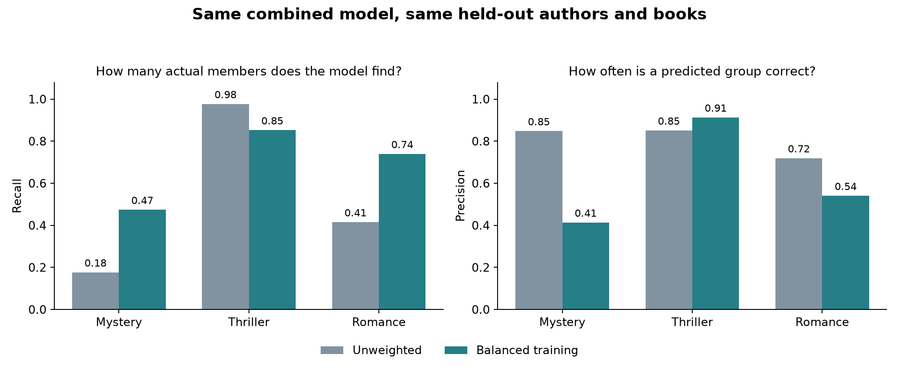

# مقایسهٔ آموزش وزن‌دار و بدون وزن

تاریخ: ۱۹ نوامبر ۲۰۲۶. این بررسی پس از تذکر کاربر دربارهٔ غالب‌شدن تریلر انجام شد. طرح قبل از اجرا در کامیت `720606a` ثبت شد. مدل‌های بدون وزن و نتیجه‌های قبلی حفظ شده‌اند. این بررسی توسعه‌ای است و آزمون نهایی نیست.

## چرا این بررسی لازم بود؟

معیارهای Macro-F1 و میانگین بازیابی به هر گروه سهم برابر در ارزیابی می‌دهند، اما مدل بدون وزن همچنان از مجموع خطای همهٔ کاربران یاد می‌گیرد. تعداد زیاد تریلرخوان‌ها می‌تواند آن مجموع را غالب کند. بنابراین استفاده از معیار متوازن به‌تنهایی معادل آموزش متوازن نیست و شکست روش بدون وزن در گروه‌های کوچک‌تر برای قضاوت نهایی کافی نبود.

از هر کاربر یک نقد داریم. وزن به گرایش رفتاریِ نویسنده داده می‌شود و ژانر کتاب ورودی مبنای آن نیست. آموزش وزن‌دار، اهمیت مجموع خطای هر سه گروه را برابر می‌کند. تعداد پیش‌بینی‌های نهایی الزاماً برابر نمی‌شود.

## وزن چگونه تعیین شد؟

در هر بخش آموزش، وزن هر شخص از گروه g برابر است با تعداد تمام کاربران آموزش تقسیم بر سه برابر تعداد کاربرانِ همان گروه. میانگین وزن یک می‌ماند و مجموع وزن هر گروه یک‌سوم مجموع وزن‌ها می‌شود. وزن‌ها فقط از آموزش همان بخش محاسبه می‌شوند؛ بخش داخلیِ انتخاب تنظیم نیز وزن‌های خودش را دارد.

| گرایش | کاربرانِ کل نمونهٔ توسعه | وزنِ صرفاً توضیحی بر اساس کل نمونه |
|---|---:|---:|
| معمایی | 948 | 3.615 |
| تریلر | 8,229 | 0.416 |
| عاشقانه | 1,104 | 3.104 |

اعداد ستون آخر صرفاً برای توضیح‌اند؛ برازش‌ها از شمار آموزش همان بخش استفاده کردند. جدول تمام وزن‌های واقعیِ هر بخش در `*_training_weights.csv` ثبت است. هیچ نمونهٔ ارزیابی حذف، تکرار یا وزن‌دهی نشد. تمام کاربران، متن‌ها، عنوان‌ها و تقسیم‌ها با بررسی بدون وزن یکسان‌اند و تطبیقِ شناسه، کتاب، گروه واقعی و بخش برای هر پیش‌بینی کنترل شد.

## نتیجهٔ کلی روی همان ۱۰٬۲۸۱ نویسنده

| روش | Macro-F1 | میانگین بازیابی گروه‌ها | دقت کلی |
|---|---:|---:|---:|
| نوشتار، بدون وزن | 0.342 | 0.357 | 0.801 |
| نوشتار، وزن‌دار | 0.390 | 0.495 | 0.501 |
| TF-IDF، بدون وزن | 0.565 | 0.511 | 0.840 |
| TF-IDF، وزن‌دار | 0.660 | 0.700 | 0.811 |
| ترکیب نوشتار و TF-IDF، بدون وزن | 0.576 | 0.523 | 0.842 |
| ترکیب نوشتار و TF-IDF، وزن‌دار | 0.649 | 0.688 | 0.805 |
| نایو بیز، بدون وزن | 0.663 | 0.673 | 0.832 |
| نایو بیز، فقط پیش‌فرضِ برابر گروه‌ها | 0.638 | 0.698 | 0.789 |
| نایو بیز، شمارهای وزن‌دار و پیش‌فرض برابر | 0.623 | 0.704 | 0.765 |

در مدل ترکیبیِ لجستیک، Macro-F1 از حدود ۰٫۵۷۶ به ۰٫۶۴۹ و میانگین بازیابی از ۰٫۵۲۳ به ۰٫۶۸۸ رسید. بازهٔ ۹۵ درصدی افزایش Macro-F1 حدود ۰٫۰۵۸ تا ۰٫۰۸۹ و افزایش میانگین بازیابی حدود ۰٫۱۵۲ تا ۰٫۱۸۰ بود. دقت کلی از حدود ۰٫۸۴۲ به ۰٫۸۰۵ کاهش یافت. معیارهای متوازن و معیار تعداد کل پاسخ درست، هدف یکسانی ندارند.

در نایو بیز، وزن‌دهی میانگین بازیابی را از حدود ۰٫۶۷۳ به ۰٫۷۰۴ رساند، اما Macro-F1 از حدود ۰٫۶۶۳ به ۰٫۶۲۳ و دقت کلی از حدود ۰٫۸۳۲ به ۰٫۷۶۵ کاهش یافت. بنابراین وزن‌دهی برای همهٔ مدل‌ها تمام معیارها را بهتر نکرد. نتیجه‌های کامل و بازهٔ تغییرها در `all_paired_metrics.csv` آمده‌اند.

## مقایسهٔ هر گروه در همان مدل واژگانیِ قبلی

این جدول نایو بیز را با خودش مقایسه می‌کند. اعداد شناسایی گروه‌ها در گزارش قبلی نیز از همین مدل بودند.

| گرایش | شناسایی بدون وزن | شناسایی وزن‌دار | دقت نسبت‌دادن بدون وزن | دقت نسبت‌دادن وزن‌دار |
|---|---:|---:|---:|---:|
| معمایی | 37.8٪ | 52.3٪ | 56.6٪ | 36.5٪ |
| تریلر | 89.6٪ | 78.8٪ | 90.3٪ | 92.2٪ |
| عاشقانه | 74.6٪ | 80.0٪ | 55.3٪ | 46.7٪ |

شناسایی یعنی سهم افراد واقعی یک گروه که پیدا شده‌اند. دقت نسبت‌دادن یعنی سهم پیش‌بینی‌های آن گروه که درست‌اند. افزایش شناسایی معمایی و عاشقانه با نسبت‌دادن اشتباهِ افراد بیشتری به این گروه‌ها همراه بود. این مبادله باید در انتخاب مدل نهایی دیده شود.

## همان مقایسه برای مدل ترکیبی

| گرایش | شناسایی بدون وزن | شناسایی وزن‌دار | دقت نسبت‌دادن بدون وزن | دقت نسبت‌دادن وزن‌دار |
|---|---:|---:|---:|---:|
| معمایی | 17.6٪ | 47.4٪ | 84.8٪ | 41.3٪ |
| تریلر | 97.7٪ | 85.2٪ | 85.1٪ | 91.3٪ |
| عاشقانه | 41.5٪ | 73.9٪ | 71.9٪ | 54.0٪ |

مدل ترکیبیِ بدون وزن 9447 نفر از ۱۰٬۲۸۱ نفر را تریلر تشخیص می‌داد. در نسخهٔ وزن‌دار این تعداد 7683 نفر شد. تعداد واقعیِ تریلرخوان‌ها ۸۲۲۹ نفر است. برابرکردن اهمیت گروه‌ها در یادگیری، به معنی وادارکردن مدل به خروجیِ یک‌سوم برای هر گروه نیست.

## بررسی ژانر کتاب مشترک

در زیرنمونهٔ نقدهای تریلر، همان ۵۵۷۹ تریلرخوان، ۸۰ معمایی‌خوان و ۶۸ عاشقانه‌خوان حفظ شدند. برای مدل ترکیبی، میانگین بازیابی از ۰٫۳۳۳ به حدود ۰٫۴۳۳ و Macro-F1 از ۰٫۳۲۹ به حدود ۰٫۳۶۷ رسید. بنابراین نتیجهٔ قبلی که مدل همه را تریلر می‌گفت، به سیاست آموزش وابسته بود و شاهد کافی برای نبود تفاوت زبانی نبود.

با این حال نتیجهٔ وزن‌دار هم قوی نیست: مدل ترکیبی فقط ۳ نفر از ۸۰ معمایی‌خوان و ۲۳ نفر از ۶۸ عاشقانه‌خوان را پیدا کرد. دقت نسبت‌دادن به این گروه‌ها به‌ترتیب حدود ۱٫۷ و ۸٫۰ درصد بود. وزن‌دهی اهمیت داده‌های موجود را تغییر می‌دهد و نمونهٔ مستقل تازه تولید نمی‌کند. برای ادعای سبک مستقل از موضوع کتاب هنوز شواهد کافی نداریم. این زیرنمونه تمام ظرفیت آرشیو برای کاربران دارای نقد تریلر نیست.

## نایو بیز: دو تغییر متفاوت

در نسخهٔ وزن‌دارِ نایو بیز، شمار واژه‌های هر گروه در وزن همان گروه ضرب شد، هموارسازی یک واحد باقی ماند و احتمال اولیهٔ سه گروه برابر شد. در نسخهٔ دیگر، فقط احتمال اولیهٔ گروه‌ها برابر شد و شمارهای واژگانیِ قبلی حفظ شدند. چون وزن ثابتِ هر گروه در فراوانی نسبی واژه‌ها تا حد زیادی خنثی می‌شود، تفاوت این دو نسخه به هموارسازی نیز مربوط است. این دو روش جدا گزارش شده‌اند و با وزن‌دهی زیان در رگرسیون لجستیک یکسان تلقی نشده‌اند.

## تصمیم جاری

آموزش متوازن باید در مقایسه‌های فاز بعد حضور داشته باشد و روش بدون وزن خط مبنا بماند. تصمیم نهایی صرفاً با دقت کلی یا افزایش شناسایی اقلیت گرفته نمی‌شود؛ Macro-F1، میانگین بازیابی و دقت نسبت‌دادن هر گروه کنار هم سنجیده می‌شوند. با هدف اهمیت برابرِ سه گرایش، نسخهٔ وزن‌دار مبنای ادامهٔ بررسی است و این انتخاب توزیع واقعیِ کاربران یا احتمال‌های جمعیتی را برابر فرض نمی‌کند.

قدرت فعلی بیشتر واژگانی است. نمونه و جدایی کتاب/نویسنده حفظ شده‌اند، اما دادهٔ ارزیابی قبلاً در توسعه استفاده شده است. بخش آزمون نهایی خوانده نشد. بازه‌ها حاصل ۲۰۰۰ بازنمونه‌گیریِ عنوان کتاب با پیش‌بینی‌های ثابت‌اند و تمام عدم‌قطعیتِ آموزش مجدد یا انتخاب روش را در بر نمی‌گیرند.



## کنترل محاسبات و بازتولید

چهار آزمون تازه، برابری سهم گروه‌ها، گرادیان عددیِ تابع وزن‌دار، یکسان‌بودن تابع وزن‌دار با نسخهٔ اصلی برای وزن‌های یک، و حذف اثر صرفِ فراوانی بر گرادیانِ ثابت مدل را کنترل کردند. تمام ۳۶ آزمون پروژه گذشتند. ۱۶۸ برازش برای تنظیم داخلی و مدل هر بخش انجام شد و همگی همگرا شدند.

```powershell
python -m unittest discover -s tests -q
python src/balanced_genre_feasibility.py
python src/report_balanced_feasibility.py
```

پیش‌بینی‌های فردی و نقاط بازیابی در `data/analysis/balanced-genre-feasibility-v1/` محلی‌اند. برای تغییر کد، ورودی یا طرح، باید پوشهٔ اجرای تازه ساخت و نتیجهٔ تازه را با نقاط بازیابی قبلی ترکیب نکرد. همهٔ مدل‌ها، وزن‌های هر بخش، تغییر معیارها و تغییر شناسایی و دقت نسبت‌دادن هر گروه در جدول‌های این پوشه ثبت‌اند.
