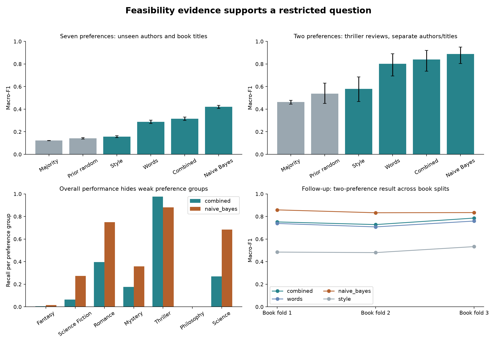

# آیا پیش‌بینی گرایش ژانری امکان‌پذیر است؟

تاریخ بررسی: ۱۹ نوامبر ۲۰۲۶. طرح اصلی پیش از برازش مدل‌ها در کامیت `88f4301` ثبت شد. این بررسی برای تصمیم دربارهٔ مسیر پروژه است و ارزیابی نهاییِ محصول یا تکمیل فاز سوم نیست.

یادداشتِ مرحلهٔ بعد: این گزارش تصمیمِ بررسی اولیه را ثبت می‌کند. پس از پیشنهاد کاربر و [بررسی سه‌ژانری](../feasibility-three/report-fa.md)، دامنهٔ جاری به معمایی، تریلر و عاشقانه تغییر کرد. [هدف جاری](../../CURRENT_GOAL.md) مرجع کار بعدی است. عددهای این گزارش تغییری نکرده‌اند.

## نتیجهٔ تصمیم

نتیجهٔ بررسی کاملاً منفی نبود. مدل اصلی برای هدف کلیِ هفت‌ژانری از معیار ازپیش‌ثبت‌شده عبور نکرد. افزودن متن به اطلاعات ژانر کتاب و طول متن نیز افزایشِ موردنیاز را در آن آزمایش ایجاد نکرد. با این حال یک مدل واژگانیِ ازقبل‌مشخص‌شده عملکرد بهتری داشت و در مقایسهٔ محدودِ دو گرایش با ژانر کتاب مشترک، نشانهٔ پیش‌بینی روشن و قابل تکرار مشاهده شد. بنابراین نتیجهٔ «هیچ رابطه‌ای وجود ندارد» با داده سازگار نیست.

در پایان این بررسی اولیه، تمایز گرایش عاشقانه و علمی‌تخیلی از متن نقد یک کتاب تریلر به‌عنوان دامنهٔ محدودِ قابل‌دفاع انتخاب شد. موفقیت در این دامنه، هدفِ تشخیص همهٔ گرایش‌ها از نوشتهٔ هر کاربر دلخواه را تأیید نمی‌کند. [اصلاحیهٔ تاریخیِ دوگروهی](../../OBJECTIVE_AMENDMENT.md) همان تصمیم را ثبت می‌کند. پیشنهاد بعدی کاربر برای سه ژانر جداگانه ارزیابی شده و دامنهٔ جاری در سندِ هدف جاری آمده است. سؤال‌های اصلی و PDF فاز اول دست‌نخورده باقی می‌مانند.

## داده و جلوگیری از آمیختگی

ارزیابی کلی شامل ۱۰٬۹۶۸ نویسنده با یک نقد از هر فرد و گرایش تک‌گروهی است. گرایش پس از حذف تمام سابقهٔ کتاب ورودی از شواهد رفتاری دوباره محاسبه شده بود. سه بخش ارزیابی اصلی عنوان کتاب مشترک ندارند و نویسندگان نیز مشترک نیستند. در بررسی حساسیت، سه بخش با جدایی نویسنده و توزیع تقریباً متوازنِ گرایش‌ها ساخته شد. برازش واژگان، IDF، جایگزینی مقدار ناموجود و مقیاس‌بندی فقط از آموزش هر بخش استفاده کرد. انتخاب ضریب منظم‌سازی نیز در یک بخش داخلی با عنوان کتاب جدا انجام شد.

در مقایسهٔ دوگروهی، از ۷۶۸ نویسندهٔ توسعه، پس از حذف عنوان‌ها و متن‌های مشترک با ارزیابی، 674 نفر برای آموزش باقی ماندند. ارزیابی جدا شامل ۱۳۵ عاشقانه‌خوان و ۲۲ علمی‌تخیلی‌خوان روی ۱۴۷ عنوان کتاب بود. همهٔ نقدها بر اساس دسته‌بندی ثبت‌شده دربارهٔ کتاب تریلرند. وجود ژانرهای فرعی یا ناقص‌بودن دسته‌بندی آمازون همچنان ممکن است.

وزن‌دهی به ژانرها، تکرار مصنوعی نمونه و حذف ژانر ضعیف برای بهبود نتیجه انجام نشد. اطلاعات امتیاز، شناسهٔ کاربر، شناسهٔ کتاب و تاریخچهٔ مطالعه ورودی مدل زبانی نبودند. ژانر کتاب و طول متن فقط در مدل تشخیصیِ زمینه استفاده شدند. شاخص‌های واژه‌نامه‌ای با همان تعریف قبلی وارد شدند و اعتبار معنایی تازه‌ای برای آن‌ها فرض نشده است.

## معیارها چه می‌گویند؟

Macro-F1 میانگین F1 گروه‌هاست و به هر گروه سهم برابر در سنجش می‌دهد. Balanced accuracy میانگین سهم افراد درست‌شناسایی‌شده در هر گروه است. این برابری در ارزیابی با وزن‌دادن به نمونه‌ها هنگام آموزش فرق دارد. دقت کلی در دادهٔ نامتوازن می‌تواند گمراه‌کننده باشد: در مسئلهٔ هفت‌گروهی، حدس همیشگی تریلر حدود ۷۵ درصد دقت کلی دارد.

## نتیجهٔ هفت‌گروهی، نویسنده و عنوان کتاب جدا

| روش | Macro-F1 | میانگین بازیابی گروه‌ها | دقت کلی |
|---|---:|---:|---:|
| حدس گروه پرتکرار | 0.122 | 0.143 | 0.750 |
| حدس تصادفی متناسب با فراوانی | 0.141 | 0.141 | 0.578 |
| شاخص‌های نوشتاری | 0.156 | 0.161 | 0.751 |
| واژگان | 0.288 | 0.248 | 0.791 |
| ترکیب نوشتار و واژگان | 0.316 | 0.270 | 0.794 |
| مدل واژگانی نایو بیز | 0.421 | 0.423 | 0.787 |
| ژانر کتاب و طول متن | 0.594 | 0.529 | 0.838 |
| زمینهٔ کتاب همراه متن | 0.578 | 0.518 | 0.854 |

بازهٔ ۹۵ درصدی Macro-F1 مدل ترکیبی از 0.300 تا 0.330 بود. حتی در گزارش تکمیلیِ شش گروهِ دارای نمونهٔ بیشتر، این مدل Macro-F1 برابر 0.369 و میانگین بازیابی 0.315 داشت. این محاسبه با کنارگذاشتن کاربران فلسفی از ارزیابیِ همان پیش‌بینی‌ها انجام شد و یک مدل شش‌کلاسهٔ تازه نیست.

مدل نایو بیز از ابتدا به‌عنوان الگوریتم ثانویه ثبت شده بود و عملکرد آن را نیز کامل گزارش کردیم. بهترشدن آن نسبت به مدل اصلی نشان می‌دهد نتیجه به نمایش متن و روش یادگیری وابسته است. این نتیجهٔ ثانویه جایگزین معیار اصلیِ ثبت‌شده نمی‌شود و مجوز نتیجه‌گیری دربارهٔ نبود تمام روابط هم نیست. گزارش هر گروه در `per_genre.csv` و تمام تقسیم‌ها در `fold_metrics.csv` موجود است.

## نتیجهٔ دوگروهی با ژانر کتاب مشترک

| روش | Macro-F1 | میانگین بازیابی دو گروه | دقت کلی |
|---|---:|---:|---:|
| حدس گروه پرتکرار | 0.462 | 0.500 | 0.860 |
| حدس تصادفی متناسب با فراوانی | 0.537 | 0.535 | 0.790 |
| شاخص‌های نوشتاری | 0.581 | 0.564 | 0.873 |
| واژگان | 0.802 | 0.746 | 0.924 |
| ترکیب نوشتار و واژگان | 0.839 | 0.807 | 0.930 |
| مدل واژگانی نایو بیز | 0.887 | 0.910 | 0.943 |

برای مدل ترکیبی، بازهٔ Macro-F1 از 0.736 تا 0.921 و بازهٔ میانگین بازیابی از 0.696 تا 0.910 بود. از ۲۲ علمی‌تخیلی‌خوان، ۱۴ نفر و از ۱۳۵ عاشقانه‌خوان، ۱۳۲ نفر درست شناسایی شدند. بنابراین عدد بالای دقت صرفاً حاصل حدس همیشگی گروه بزرگ‌تر نیست. با این حال تعداد علمی‌تخیلی‌خوان‌ها برای تخمین دقیق خطا همچنان کم است.

مدل صرفاً مبتنی بر طول متن همان نتیجهٔ حدس گروه بزرگ‌تر را داشت. افزایش مدل ترکیبی نسبت به آن و نسبت به حدس گروه بزرگ‌تر، در هر دو معیار بیش از پنج واحد درصد بود و بازهٔ اختلاف کاملاً مثبت بود. جدول کامل اختلاف‌ها در `paired_intervals.csv` ثبت است.

## بررسی تکمیلیِ نتیجهٔ محدود

پس از مشاهدهٔ نتیجهٔ اولیه، بررسی تکمیلی با طرح جداگانه ثبت شد. این مرحله تأییدِ ازپیش‌ثبت‌شدهٔ مستقلی محسوب نمی‌شود. سه بخش با عنوان کتاب جدا در همان ۷۶۸ نویسندهٔ توسعه ساخته شد و هیچ تنظیم یا ویژگی تازه‌ای به مدل اضافه نشد.

| روش | Macro-F1 در سه بخش | میانگین بازیابی دو گروه |
|---|---:|---:|
| حدس گروه پرتکرار | 0.461 | 0.500 |
| شاخص‌های نوشتاری | 0.500 | 0.516 |
| واژگان | 0.737 | 0.685 |
| ترکیب نوشتار و واژگان | 0.758 | 0.712 |
| مدل واژگانی نایو بیز | 0.843 | 0.823 |

حداکثر شباهت کسینوسی متن‌های ارزیابی به متن‌های آموزش در نمایش واژگانی 0.479 بود. هیچ متن ارزیابی از آستانه‌های ۰٫۶ یا ۰٫۸ عبور نکرد. در این سنجش، نتیجه با نسخه‌های تقریباً یکسانِ متن توضیح داده نمی‌شود. این بررسی تمام صورت‌های بازنویسی یا وابستگیِ مجموعه‌کتاب‌ها و نویسندگان کتاب را رد نمی‌کند.

## این الگو چه معنایی دارد؟

شواهد فعلی عمدتاً واژگانی‌اند. شاخص‌های ساختار نوشتار به‌تنهایی قدرت اندکی داشتند. در توضیح توصیفی مدل، واژه‌هایی مثل love، romance و suspense بیشتر به سوی گروه عاشقانه و science، fiction و human بیشتر به سوی علمی‌تخیلی سهم داشتند. این فهرست، توضیح محاسبهٔ مدل است و نباید به‌عنوان واژه‌نامهٔ ادبیِ تأییدشده یا ویژگی شخصیتی افراد خوانده شود. بخشی از تفاوت می‌تواند از ژانرهای فرعی، اشارهٔ صریح به ژانر و سبکِ نقدنویسیِ گروه‌های خاص مانند دریافت‌کنندگان نسخهٔ پیش از انتشار ناشی شود.

## تصمیم و محدودیت

وضع معیار ثبت‌شده: معیار کلی = False، افزایش پس از کنترل زمینه = False، مقایسهٔ ژانر مشترک = True. بنابراین تصمیم اولیهٔ ادامهٔ هدف گسترده همان `False` باقی مانده و برای بهترکردن نتیجه تغییر نکرده است. مسیر محدودِ دوگروهی به‌عنوان اصلاح دامنه انتخاب می‌شود و نیازمند ارزیابی نهاییِ جداگانه است.

کاربران ارزیابیِ دوگروهی پیش‌تر در EDA و ممیزی واژه‌ها بررسی شده‌اند. در نتیجه این دادهٔ توسعه است و یک آزمون نهاییِ دست‌نخورده نیست. متن‌های بخش آزمون نهایی در این کار باز نشدند. بازه‌ها با ۲۰۰۰ بازنمونه‌گیری عنوان کتاب و ثابت نگه‌داشتن پیش‌بینی‌ها محاسبه شده‌اند و تمام عدم‌قطعیت ناشی از آموزش دوبارهٔ مدل یا انتخاب دامنه را پوشش نمی‌دهند. کاربرد روی کاربر با گرایش دیگر، متن غیرنقد، زبان دیگر یا ژانر دیگرِ کتاب هنوز ارزیابی نشده است.

برای فاز بعد، نمونه و معیارهای همین سؤال محدود باید تثبیت شوند، سهم واژگان در برابر ساختار و اشارهٔ مستقیم به ژانر سنجیده شود، و ارزیابی نهایی با نویسندگان و کتاب‌های جدا انجام شود. این مرحله مدل نهایی یا نتیجهٔ نهایی پروژه نیست.



## بازتولید و خروجی‌ها

```powershell
python -m unittest discover -s tests -p test_predictive_feasibility.py -v
python src/predictive_feasibility.py all
python src/audit_common_prediction.py
python src/build_predictive_feasibility_report.py
```

برای محدودکردن مصرف منابع می‌توان پیش از اجرا `OPENBLAS_NUM_THREADS=1` و `OMP_NUM_THREADS=1` تنظیم کرد. همهٔ ضرایب انتخاب‌شده، تعداد تکرار بهینه‌ساز و نتیجهٔ همگرایی در `*_fit_diagnostics.csv` ثبت‌اند. پیش‌بینی‌های فردی و نقاط بازیابی اجرا در `data/analysis/predictive-feasibility-v1/` محلی می‌مانند. تغییر کد یا ورودی‌ها مستلزم اجرای تازه در پوشهٔ خروجی تازه است و نباید با نقاط بازیابیِ قدیمی ترکیب شود.
