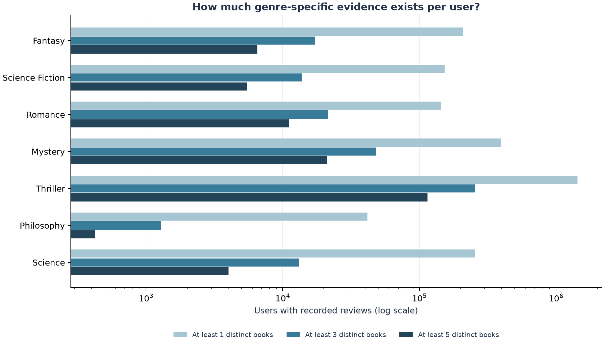
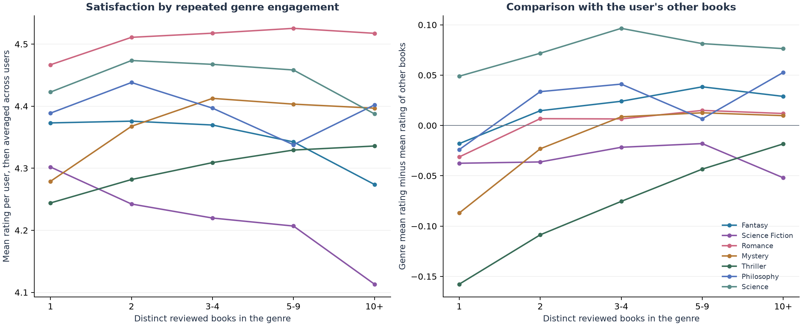
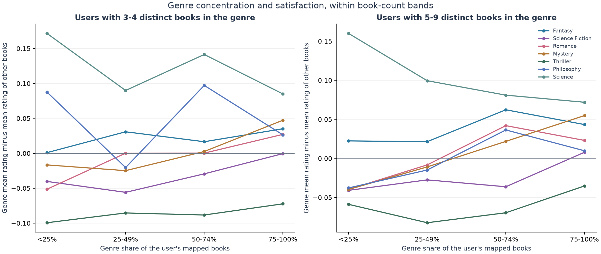
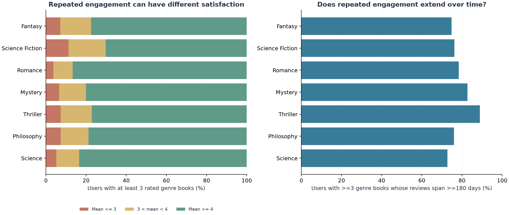

# بررسی اکتشافی گرایش ژانری و رضایت کاربران

این بررسی برای انتخاب تعریف مناسب ترجیح ژانر انجام شده است. هیچ برچسب «علاقه‌مند» یا «بی‌علاقه» تولید نشده است.

## یافته‌های اصلی

- **66.9%** از کاربران دارای نگاشت، فقط یک کتاب نگاشت‌شده دارند؛ سهم بالا بدون کفایت تعداد مشاهدات قابل تفسیر نیست.
- در مجموع **26,176 جفت کاربر و ژانر** با حداقل سه کتاب و سه امتیاز معتبر، میانگین امتیاز حداکثر ۳ دارند. یک فرد می‌تواند در چند ژانر شمرده شود. تکرار و رضایت باید جدا بررسی شوند.
- میانگین امتیاز گروه دارای ۱۰ کتاب یا بیشتر، در **4 ژانر بالاتر** و در **3 ژانر پایین‌تر** از گروه تک‌کتاب است. مقایسه بین گروه‌های متفاوت کاربران است و تغییر امتیاز یک فرد در طول زمان را اندازه نمی‌گیرد.
- مثال معمایی: میانگین گروه تک‌کتاب **4.28** و گروه دارای حداقل ۱۰ کتاب **4.40** است؛ اندازهٔ گروه‌ها در فایل تجمیعی ثبت شده است.
- مثال علمی‌تخیلی: میانگین گروه تک‌کتاب **4.30** و گروه دارای حداقل ۱۰ کتاب **4.11** است؛ اندازهٔ گروه‌ها در فایل تجمیعی ثبت شده است.

## دامنه و روش

- تمام **29,475,453 سطر** آرشیو نقدها پردازش شد؛ نمونه‌گیری انجام نشد.
- **10,297,355 کاربر** در کل آرشیو و **2,235,350 کاربر** با دست‌کم یک کتاب دارای نگاشت معتبر مشاهده شد.
- **29,139,329 جفت متمایز کاربر و کتاب** وجود داشت؛ **5,208,295 جفت** به هفت گروه منتخب نگاشت شدند.
- فاصلهٔ تعداد سطرهای دارای شناسهٔ معتبر کاربر تا جفت‌های متمایز، **336,124 سطر** است. این اختلاف، رکوردهای یکسان و نقدهای متفاوت از یک جفت را با هم شامل می‌شود؛ شمارش صرفاً تکرار کامل نیست.
- نقدهای هر کاربر با پارتیشن‌بندی هش در کل فایل تجمیع شدند؛ پیوسته‌بودن سطرهای یک کاربر فرض نشده است.
- شناسهٔ کتاب همان `parent_asin` است. این شناسه تضمین نمی‌کند نسخه‌های مختلف یک اثر ادبی حتماً یک کتاب شمرده شوند.
- از هر جفت کاربر و کتاب، یک کتاب شمرده شد. برای امتیاز، آخرین امتیاز معتبر با زمان معتبر انتخاب شد؛ در تساوی زمان، امتیاز پایین‌تر و در نبود زمان معتبر، امتیاز موجود با همان قاعدهٔ رفع تساوی نگه داشته شد.
- برای تداوم، زمان اولین نقد معتبر هر کتاب مبناست. نقد مجدد همان کتاب در فصل دیگری، شواهد دنبال‌کردن کتاب تازه ایجاد نمی‌کند. فصل‌ها سه‌ماههٔ تقویمی میلادی و زمان‌ها UTC هستند.
- سهم ژانر هم نسبت به کل کتاب‌های دارای نگاشت معتبر و هم نسبت به تمام کتاب‌های کاربر ثبت شد. کتاب‌های مبهم یا بیرون از نگاشت از مخرج کل سابقه حذف نشده‌اند.
- رضایت با میانگین امتیاز، سهم امتیازهای ۴ و ۵ و سهم امتیازهای ۱ و ۲ توصیف شد. امتیاز مثبت شرط شمارش گرایش نیست.
- برای مقایسهٔ رضایت، اختلاف میانگین امتیاز ژانر با میانگین سایر کتاب‌های همان کاربر نیز محاسبه شد. کاربرانی که کتاب امتیازدار دیگری ندارند از این مقایسه کنار گذاشته می‌شوند.

## مقدار شواهد موجود

| ژانر | کاربران با ≥۱ کتاب | با ≥۳ کتاب | با ≥۵ کتاب | سهم ژانر از جفت‌های دارای نگاشت |
|---|---:|---:|---:|---:|
| فانتزی | 207,550 | 17,138 | 6,509 | 6.0% |
| علمی‌تخیلی | 153,184 | 13,819 | 5,486 | 4.7% |
| عاشقانه | 143,728 | 21,528 | 11,143 | 6.2% |
| معمایی | 395,557 | 48,389 | 21,046 | 14.4% |
| تریلر | 1,432,932 | 255,398 | 114,644 | 61.4% |
| فلسفی | 41,608 | 1,284 | 423 | 1.0% |
| علمی | 255,054 | 13,196 | 4,009 | 6.4% |



از کاربران دارای نگاشت، **1,494,790 نفر (66.9%)** فقط یک کتاب دارای نگاشت دارند. سهم ۱۰۰٪ یک ژانر برای این کاربران، به‌تنهایی شواهد کافی ترجیح پایدار نیست.
**310,588 کاربر** در بیش از یک گروه منتخب نقد کتاب دارند؛ این عدد، تعداد کاربران با چند علاقهٔ تأییدشده نیست.

پوشش نگاشت در سابقهٔ کاربران دارای دست‌کم یک کتاب نگاشت‌شده:

| سهم کتاب‌های قابل‌نگاشت از تمام کتاب‌های کاربر | تعداد کاربران | سهم کاربران دارای نگاشت |
|---|---:|---:|
| <25% | 291,796 | 13.1% |
| 25-49% | 371,412 | 16.6% |
| 50-74% | 498,038 | 22.3% |
| 75-100% | 1,074,104 | 48.1% |

## رابطهٔ تکرار و رضایت

در جدول زیر، ابتدا میانگین امتیاز هر کاربر در ژانر محاسبه و سپس این میانگین‌ها با وزن برابر بین کاربران میانگین‌گیری شده‌اند. همهٔ ژانرها با گروه‌های فعالیت یکسان مقایسه نشده‌اند؛ جدول توصیفی است و اثر علّی تکرار بر رضایت را نشان نمی‌دهد.

| ژانر | یک کتاب | دو کتاب | ۳ تا ۴ کتاب | ۵ تا ۹ کتاب | ۱۰ کتاب یا بیشتر |
|---|---:|---:|---:|---:|---:|
| فانتزی | 4.37 | 4.38 | 4.37 | 4.34 | 4.27 |
| علمی‌تخیلی | 4.30 | 4.24 | 4.22 | 4.21 | 4.11 |
| عاشقانه | 4.47 | 4.51 | 4.52 | 4.53 | 4.52 |
| معمایی | 4.28 | 4.37 | 4.41 | 4.40 | 4.40 |
| تریلر | 4.24 | 4.28 | 4.31 | 4.33 | 4.34 |
| فلسفی | 4.39 | 4.44 | 4.40 | 4.34 | 4.40 |
| علمی | 4.42 | 4.47 | 4.47 | 4.46 | 4.39 |



پنل راست، تفاوت امتیاز ژانر با سایر کتاب‌های همان فرد را نشان می‌دهد. این مقایسه، بخشی از تفاوت افراد در نمره‌دهی را لحاظ می‌کند، اما کنترل کامل تفاوت کاربران، محبوبیت، مواجهه یا انتخاب کتاب‌ها نیست. مخرج هر گروه در `rating_by_count.csv` ثبت شده است.

| ژانر | یک کتاب با امتیاز ۴ یا ۵ | ≥۳ کتاب با ≥۳ امتیاز معتبر | از این گروه، میانگین ≤۳ | از این گروه، میانگین ≥۴ |
|---|---:|---:|---:|---:|
| فانتزی | 141,110 | 17,138 | 1,221 (7.1%) | 13,288 (77.5%) |
| علمی‌تخیلی | 100,589 | 13,819 | 1,548 (11.2%) | 9,702 (70.2%) |
| عاشقانه | 91,576 | 21,528 | 799 (3.7%) | 18,659 (86.7%) |
| معمایی | 241,319 | 48,389 | 3,209 (6.6%) | 38,749 (80.1%) |
| تریلر | 769,175 | 255,398 | 18,626 (7.3%) | 197,146 (77.2%) |
| فلسفی | 31,599 | 1,284 | 94 (7.3%) | 1,012 (78.8%) |
| علمی | 184,537 | 13,196 | 679 (5.1%) | 11,007 (83.4%) |

ستون اول نمونه‌هایی از رضایت ثبت‌شده با تنها یک کتاب در ژانر را می‌شمارد. ستون‌های بعدی نشان می‌دهند تکرار می‌تواند با سطوح متفاوت رضایت همراه باشد. این گروه‌ها به‌عنوان حقیقت مبنای علاقه یا بی‌علاقگی اعتبارسنجی نشده‌اند.

## رابطهٔ سهم ژانر و رضایت



در این شکل، رابطهٔ سهم ژانر با امتیازدهی نسبی در دو بازهٔ تعداد کتاب بررسی شده است تا مقایسه صرفاً میان تک‌مشاهده‌ها و کاربران بسیار فعال نباشد. مخرج سهم، کتاب‌های دارای نگاشت معتبر است و امتیاز نسبی با تمام کتاب‌های امتیازدار دیگر فرد مقایسه می‌شود. تعداد کاربران و مقایسهٔ حساسیت با شرط پوشش نگاشت حداقل ۵۰٪ در `rating_by_share.csv` آمده است. تفاوت ترکیب کاربران و فرصت مواجهه همچنان باقی است.

## تداوم زمانی و حساسیت تعریف

| ژانر | کاربران با ≥۳ کتاب | از این گروه، ≥۲ فصل فعال | از این گروه، ≥۳ کتاب تاریخ‌دار با فاصلهٔ ≥۱۸۰ روز |
|---|---:|---:|---:|
| فانتزی | 17,138 | 14,415 (84.1%) | 12,825 (74.8%) |
| علمی‌تخیلی | 13,819 | 11,683 (84.5%) | 10,536 (76.2%) |
| عاشقانه | 21,528 | 19,254 (89.4%) | 16,880 (78.4%) |
| معمایی | 48,389 | 43,552 (90.0%) | 40,039 (82.7%) |
| تریلر | 255,398 | 242,917 (95.1%) | 226,958 (88.9%) |
| فلسفی | 1,284 | 1,083 (84.3%) | 976 (76.0%) |
| علمی | 13,196 | 10,568 (80.1%) | 9,601 (72.8%) |



حضور در دو فصل می‌تواند با فاصلهٔ یک روز در مرز فصل‌ها رخ دهد؛ بنابراین تعداد فصل و فاصلهٔ زمانی جدا گزارش شده‌اند.
شبکهٔ تشخیصی شامل حداقل ۲، ۳، ۵ یا ۱۰ کتاب، سهم حداقل ۲۵٪، ۵۰٪ یا ۷۵٪ از کتاب‌های قابل‌نگاشت و حضور در حداقل ۱، ۲ یا ۴ فصل است. شمارش‌ها یک‌بار برای همهٔ کاربران دارای نگاشت و یک‌بار با شرط پوشش نگاشت حداقل ۵۰٪ ثبت شده‌اند. این آستانه‌ها سناریوهای توصیفی‌اند و هیچ‌کدام تعریف نهایی ترجیح نیستند.

## نتیجه برای طراحی پروژه

- تعداد کتاب، سهم ژانر، تداوم زمانی و رضایت باید به‌صورت ابعاد جدا باقی بمانند تا رابطهٔ آن‌ها قابل بررسی باشد.
- سهم زیاد با یک مشاهده یا پوشش ضعیف نگاشت باید همراه با مقدار شواهد گزارش شود.
- میانگین امتیاز بالا برای یک کتاب و مراجعهٔ مکرر به یک ژانر، دو الگوی متفاوت مشاهده‌شده‌اند. هیچ‌کدام به‌تنهایی علاقهٔ واقعی را تأیید نمی‌کند.
- پیش از انتخاب برچسب، لازم است کفایت متن ورودی و شواهد ژانری در بازهٔ مستقل بعدی هم‌زمان بررسی شود. این مطالعه، شمارش نمونهٔ نهایی پیش‌بینی نیست.

## محدودیت‌ها و حدود استفاده

این آرشیو همهٔ خریدها، مطالعه‌ها یا مواجهه‌های کاربر را ثبت نمی‌کند. زمان نقد هم لزوماً زمان مطالعه نیست. نبود نقد از یک ژانر شاهد بی‌علاقگی نیست. شواهدی از علاقهٔ واقعی برای سنجش اعتبار معیارهای پیشنهادی نداریم؛ این تحلیل روابط میان رفتار نقدنویسی و رضایت ثبت‌شده را توصیف می‌کند.

سهم جمعیتی ژانرها، توصیف نقدهای موجود است و احتمال مواجههٔ هر فرد با ژانر را مشخص نمی‌کند. نویسنده و مجموعه در این اجرای اولیه تحلیل نشده‌اند؛ تمرکز روی یک مجموعه می‌تواند بخشی از تکرار را توضیح دهد.

طول فرصت مشاهده بین کاربران برابر نیست. کاربران تازه‌وارد یا افرادی که نقدهایشان نزدیک انتهای آرشیو ثبت شده است، فرصت کمتری برای ایجاد سابقهٔ طولانی دارند. جمع‌بندی کل سابقه می‌تواند تغییر گرایش فرد در طول زمان را نیز پنهان کند؛ بررسی بازه‌های زمانی مستقل در مرحلهٔ بعد لازم است.

این بررسی کل بازهٔ آرشیو را پوشش می‌دهد. برای مدل پیش‌بینی، باید بازهٔ ویژگی و بازهٔ هدف و کاربران آموزش/اعتبارسنجی/آزمون مستقل تعریف شوند؛ قواعد و پارامترها پیش از ارزیابی نهایی تثبیت شوند. نمایهٔ کل‌سابقه نباید مستقیماً به‌عنوان ویژگی پیش‌بینی آینده استفاده شود.

هر کاربر ممکن است در چند ردیف ژانری حضور داشته باشد؛ ردیف‌های ژانری مستقل نیستند. آزمون معناداری، ادعای علّی یا برآورد اعتبار تشخیص علاقه انجام نشده است.

## بازاجرا و فایل‌ها

```powershell
python src/user_genre_profiles.py --expected-rows 29475453
python src/report_user_genres.py
```

اجرای اول از مسیر خروجی خالی استفاده می‌کند و فایل‌های موجود را بازنویسی نمی‌کند. برای اجرای مجدد، `--output-dir` و `--report-dir` تازه تعیین کنید و مسیر خلاصه را با `--summary` به اسکریپت گزارش بدهید.

- `data/user_genre_profiles/user_profiles.csv`: نمایهٔ کاربران دارای حداقل یک کتاب نگاشت‌شده، شامل اندازهٔ کل سابقه و پوشش نگاشت.
- `data/user_genre_profiles/user_genre_profiles.csv`: تعداد، سهم، رضایت و تداوم برای هر جفت کاربر و ژانر مشاهده‌شده.
- شناسه‌ها با هش بدون نمک جایگزین شده‌اند؛ مستعارند و تضمین ناشناس‌بودن ندارند. فایل‌های فردی در پوشهٔ محلیِ نادیده‌گرفته‌شدهٔ `data/` باقی می‌مانند.
- `summary.json`، `rating_by_count.csv`، `rating_by_share.csv` و `diagnostic_threshold_grid.csv`: فقط نتایج تجمیعی، همراه با شکل‌های همین گزارش.
- متن خام نقدها در خروجی فردی یا گزارش ذخیره نشده است. تعداد کتاب‌های دارای متن غیرخالی، سنجش کفایت حجم متن نیست.

خطاهای ثبت‌شدهٔ ورودی:

```json
{
  "raw_rows": 29475453,
  "invalid_rating_rows": 4,
  "invalid_timestamp_rows": 0
}
```

تفسیر فراوانی به‌عنوان میزان شواهد، با الهام از [Hu, Koren & Volinsky (2008)](https://yifanhu.net/PUB/cf.pdf) است. تعریف ژانری این پروژه، مستقیماً از آن مقاله اخذ یا اعتبارسنجی نشده است.
