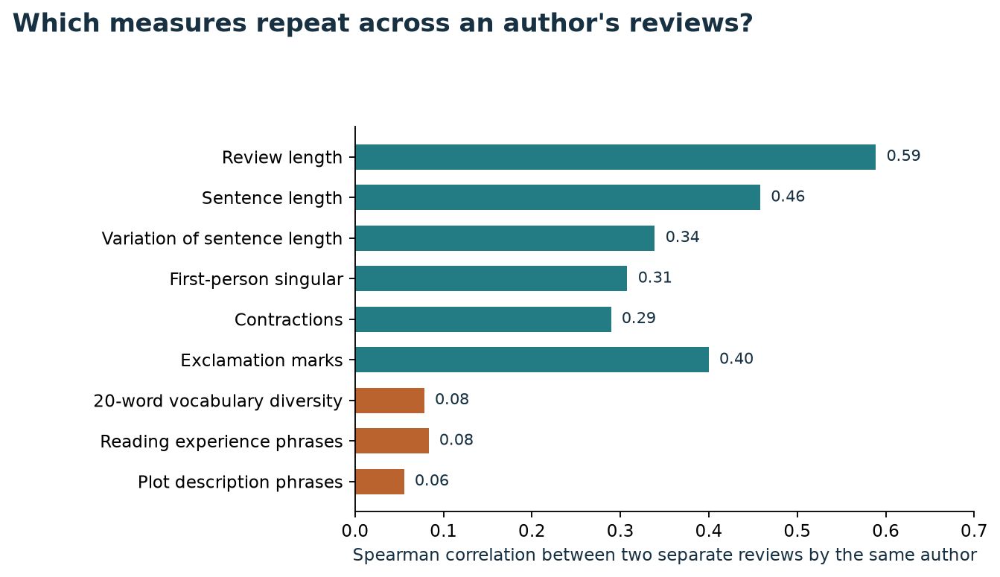
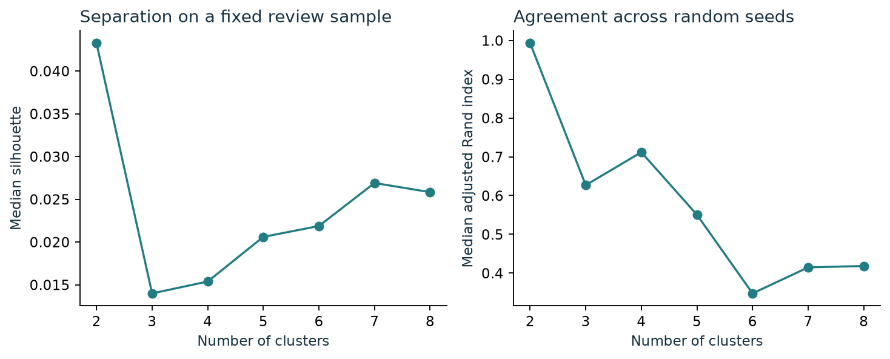
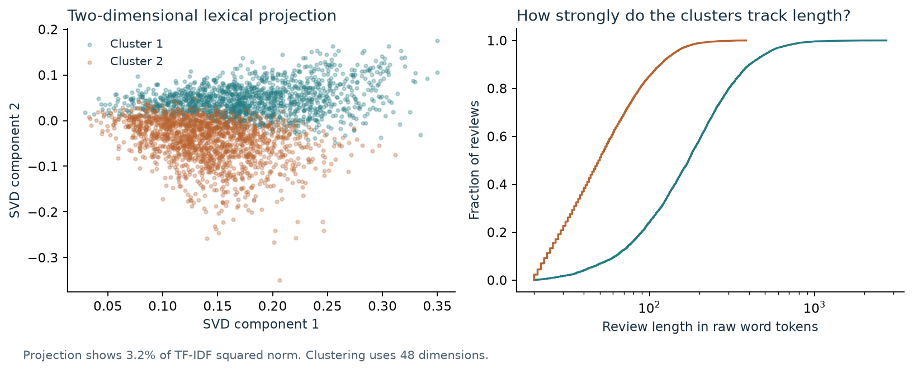
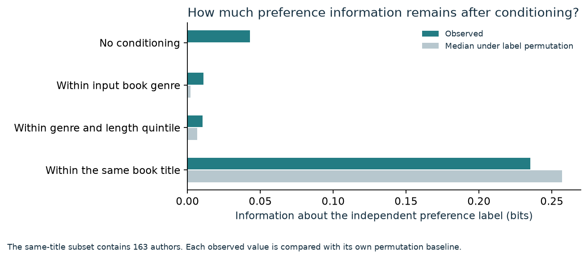
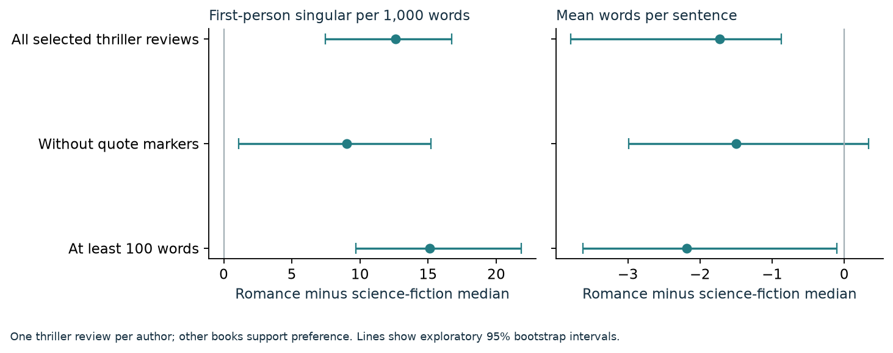

# گزارش فاز دوم

## مسئله، داده و دامنهٔ نتیجه

سؤال ۱۰ فاز اول مبنای این کار است. با استفاده از ویژگی‌های سبک‌شناختی، واژگانی و معناییِ نقدهای کاربران، تا چه حد می‌توان ژانرهای موردعلاقهٔ آن‌ها را پیش‌بینی کرد؟ نویسندهٔ تازه فقط متنش را ارائه می‌کند. گرایش مرجع در این پژوهش از الگوی رفتار نقدنویسی برآورد می‌شود.

این فاز زنجیرهٔ آماده‌سازی، اندازه‌گیری ویژگی‌ها و کشف الگو را کامل می‌کند. هدف این گزارش شناخت کیفیت شواهدی است که بعداً برای پیش‌بینی کاربرِ دیده‌نشده به کار می‌روند. واحد مشاهده نقد و واحد موضوعِ استنباط کاربر است.

دادهٔ تثبیت‌شده شامل ۵۸۴٬۳۵۶ نقد از ۱۷٬۰۲۲ کاربر است. شاخص‌های ثابت قبلاً برای تمام این نقدها محاسبه شدند. برازش واژگان، مقیاس‌ها و خوشه‌های این دور فقط روی بخش توسعه انجام شد. از هر یک از ۱۱٬۹۱۲ نویسنده یک نقد با هش ثابت برگزیده شد. هر نویسنده به یک اندازه در تحلیل اصلی حضور دارد.

نقدهای انتخابی دربارهٔ ۹٬۶۲۰ کتاب متمایز هستند. همگی پس از پاک‌سازی اولیه متن‌های متمایزی داشتند. ۲٬۸۷۷ نقد به کتاب‌هایی خارج از نگاشت هفت‌ژانری مربوط‌اند. در چنین مواردی ژانر کتاب «بدون نگاشت» ثبت می‌شود. هدف همچنان برآورد گرایش نویسنده است.

## کدام شاخص‌ها به نویسنده مربوط‌اند؟

۲۹ شاخص ثابت شامل حجم و سازمان متن، طول و پراکندگی جمله، تنوع واژگانی، ضمایر، صورت‌های کوتاه، نشانه‌گذاری و عبارت‌های مرتبط با قضاوت و کارکرد نقد هستند. برای هر شاخص، صورت و مخرجِ شمارش نیز حفظ شده است. جدول کامل نام‌ها، واحدها و میانه‌های هر هفت گروه در گزارش سبک همراه پروژه آمده است.

برای سنجش انتقال از یک نقد به نقد دیگر، برای هر نویسنده نقد دومی از کتابی دیگر با هش مستقل انتخاب شد. همبستگی رتبه‌ای دو نقد در نمودار زیر آمده است. حتی شاخص‌هایی که در نمایهٔ مجموعِ نقدها تفاوت دارند، ممکن است در یک نقد کوتاه ناپایدار باشند.

در ۱۱٬۹۱۲ جفت، طول جمله حدود ۰٫۴۶ تکرارپذیری دارد و تنوعِ واژه در پنجره‌های ۲۰واژه‌ای حدود ۰٫۰۸. این تعریف تنوع واژگان برای نمایندگی پایدارِ سبک یک نفر شواهد ضعیفی فراهم می‌کند. رابطهٔ این شاخص‌ها در نقدهای هم‌ژانر و نقدهای بلند نیز جداگانه ذخیره شده است.

در خودِ نمایهٔ کاربران، طول نقد و تعداد جمله‌ها همبستگی ۰٫۹۴ دارند. طول متوسط جمله با انحراف معیار آن ۰٫۸۳ همبستگی دارد. وابستگی شاخص‌ها باید هنگام انتخاب ورودی‌های مدل لحاظ شود.

## آیا برچسب از نقدهای دیگر می‌آید؟

کل آرشیو ۲۹٬۴۷۵٬۴۵۳نقدی دوباره برای کاربران نمونه خوانده شد. شمار کتاب‌های متمایز، سهم ژانر، نخستین تاریخ هر کتاب، گسترهٔ زمانی و سه‌ماهه‌های فعال بازسازی شدند. عضویت حاصل برای تمام ۱۱٬۹۱۲ کاربر دقیقاً با نسخهٔ تثبیت‌شده تطبیق داشت.

سپس تمام سوابق کتابِ نقد ورودی از سابقهٔ فرد کنار گذاشته شدند. همان قواعد حداقل سه کتاب، سهم حداقل ۵۰٪، گسترهٔ زمانی دست‌کم ۱۸۰ روز و دست‌کم دو سه‌ماهه دوباره اعمال شدند. شرط کفایت متن برای انتخاب نمونه از نسخهٔ تثبیت‌شده می‌آید.

پس از این حذف، ۱۰٬۹۶۸ نفر یک گرایش و ۵ نفر دو گرایش داشتند. برای ۹۳۹ نفر شواهد باقی‌مانده به آستانه‌ها نرسید. تحلیل بیرونیِ واژگان و ارتباط خوشه با گرایش بر کاربران تک‌گرایشی با این شواهد مستقل انجام شد.

این جدول میزان وابستگی برچسب به یک کتاب را نشان می‌دهد. مقادیر گرایش، تعریف عملیاتیِ رفتار در آرشیو هستند. علاقهٔ ذهنیِ واقعی و تمام کتاب‌های خوانده‌شده در این داده مشاهده نمی‌شوند.

| گرایش | عضویت اولیه | حفظ‌شده | ازدست‌رفته |
|---|---|---|---|
| فانتزی | ۲۵۸ | ۱۸۹ | ۶۹ |
| علمی‌تخیلی | ۳۷۷ | ۲۹۵ | ۸۲ |
| عاشقانه | ۱٬۲۵۲ | ۱٬۱۰۴ | ۱۴۸ |
| معمایی | ۱٬۰۴۰ | ۹۴۹ | ۹۱ |
| تریلر | ۸٬۷۳۷ | ۸٬۲۳۳ | ۵۰۴ |
| فلسفی | ۱۵ | ۱۰ | ۵ |
| علمی | ۲۳۹ | ۱۹۳ | ۴۶ |

## واژگان چگونه به ویژگی تبدیل شد؟

برای بازنمایی واژگانی، موجودیت‌های HTML رمزگشایی، تگ‌های رایج قالب‌بندی پاک، آدرس‌های وب حذف و حروف کوچک شدند. در شش متن، حروف تزئینی انگلیسی سهم زیادی از نویسه‌ها داشتند. بازخوانی نشان داد این موارد عمدتاً نمایش تزئینیِ انگلیسی‌اند. در مسیر واژگانی از نرمال‌سازی NFKC استفاده شد تا همان کلمه دو ویژگی متفاوت نسازد.

مسیر اندازه‌گیری سبک نشانه‌گذاری و بزرگی حروف را حفظ می‌کند. حذف کلمات نقشی فقط در بازنمایی واژگانی انجام می‌شود. تک‌واژه‌ها و زوج‌واژه‌های مجاور با صورت کامل حفظ می‌شوند. تعداد ویژگی‌های نهایی ۱۲هزار است. هر ویژگی در حداقل پنج و حداکثر ۶۵٪ نقدهای توسعه حضور دارد.

برای هر واژه، فراوانی به یک به‌علاوهٔ لگاریتم تعداد تبدیل و در وزن معکوس فراوانی سند ضرب می‌شود. وزن IDF برابر یک به‌علاوهٔ لگاریتم نسبتِ یک‌به‌علاوهٔ تعداد سندها به یک‌به‌علاوهٔ تعداد سندهای حاوی واژه است. هر ردیف سپس طول یک می‌گیرد.

ماتریس تنکِ ۱۱٬۹۱۲ در ۱۲٬۰۰۰، تعداد ۷۴۶٬۳۴۸ خانهٔ غیرصفر دارد. SVD تصادفی با سه تکرار توان، بذر ثابت ۴۱۲ و ۴۸ مؤلفه اجرا شد. این مؤلفه‌ها حدود ۱۰٫۰۹٪ انرژیِ مربع طول ماتریس را حفظ می‌کنند. در ۲۴ مؤلفه این مقدار ۷٫۳۵٪ است.

هدف SVD ساخت بازنمایی فشرده برای بررسی الگو و خوشه‌بندی است. نمایش دوبعدی فقط ۳٫۲۳٪ انرژی را حفظ می‌کند و باید همراه با معیارهای فضای ۴۸بعدی خوانده شود. پارامترها، واژگان و مؤلفه‌ها ذخیره شده‌اند و برای یک متن تازه قابل اعمال‌اند.

## چند خوشه قابل دفاع است؟

k-means با شروع k-means++ برای تعداد خوشه‌های ۲ تا ۸ و چهار بذرِ ۴۱۲ تا ۴۱۵ اجرا شد. هر اجرا ۵۵ تکرار داشت. سیلوئت روی نمونهٔ ثابت حداکثر ۱٬۸۰۰نقدی محاسبه شد. توافق شروع‌ها با شاخص تعدیل‌شدهٔ رند سنجیده شد.

برای محدودکردن انتخاب‌های شکننده، سهم کوچک‌ترین خوشه حداقل ۲٪ و توافق شروع‌ها حداقل ۰٫۷ در نظر گرفته شد. از میان گزینه‌های واجد شرایط، بیشترین میانهٔ سیلوئت و در تساوی، تعداد خوشهٔ کمتر انتخاب شد. این آستانه‌ها تصمیم اکتشافی این پروژه‌اند.

دو خوشه انتخاب شدند. میانهٔ سیلوئت ۰٫۰۴۳ و توافق شروع‌ها ۰٫۹۹۳ بود. جدایی ضعیف است، هرچند تقسیم در برابر شروع تصادفی تکرارپذیر است. تعداد خوشه با تعداد ژانرها برابر فرض نشد.

| تغییر در تحلیل | توافق با تقسیم اصلی |
|---|---|
| برازش مجدد روی ۸۰٪ | ۰٫۹۰۹ |
| برازش مجدد روی ۸۰٪ | ۰٫۹۱۵ |
| برازش مجدد روی ۸۰٪ | ۰٫۹۰۵ |
| حذف نرمال‌سازی ردیف | ۰٫۴۷۳ |
| ۲۴ مؤلفه | ۰٫۸۰۷ |
| ۹۶ مؤلفه | ۰٫۷۹۵ |
| حذف بیشتر کلمات نقشی | ۰٫۷۲۸ |

## خوشه‌ها بیشتر چه تفاوتی دارند؟

در بازخوانی نمونه‌های نزدیک به مرکز هر خوشه، گروه اول بیشتر شامل توصیه‌ها و ارزیابی‌های مثبت و کوتاه بود. گروه دوم نقدهای مفصل‌تر با شرح داستان یا نقد جزئیات را بیشتر پوشش می‌داد. این توصیف، تفسیر نمونه‌ها و ویژگی‌های اندازه‌گیری‌شده است.

طول میانهٔ نقد در دو خوشه اختلاف زیادی دارد. ارتباط تقسیم با پنجک طول نقد از ارتباطش با گرایش نویسنده بیشتر است. امتیاز متوسط و تعداد رأی مفید نیز فرق دارند. این تفاوت‌ها نشان می‌دهند چند عامل در شکل‌گیری الگو دخیل‌اند.

| خوشه | کاربران | میانهٔ طول نقد | میانگین امتیاز |
|---|---|---|---|
| ۱ | ۵٬۶۴۲ | ۱۷۳ | ۴٫۰۷ |
| ۲ | ۶٬۲۷۰ | ۵۰ | ۴٫۴۳ |

## پس از لحاظ‌کردن موضوع چه باقی می‌ماند؟

ارتباط خوشه و برچسب مستقلِ گرایش با اطلاعات متقابل بر حسب بیت اندازه گرفته شد. برای مقایسه، برچسب‌ها ۴۹۹ بار در همان لایه‌ها جابه‌جا شدند. در حالت مشروط به ژانر کتاب و طول، جابه‌جایی فقط داخل همان ژانر و همان پنجک طول انجام شد.

رابطهٔ خام با گرایش نویسنده دیده می‌شود، اما پس از لحاظ‌کردن ژانر کتاب و طول، مقدارِ افزوده نسبت به میانهٔ جابه‌جایی بسیار کوچک‌تر است. p حاصل از جابه‌جایی و اصلاح بنجامینی–هوچبرگ برای هفت مقایسه در جدول داده ثبت شده است. کم‌بودن p باید همراه با اندازهٔ رابطه خوانده شود.

برای مقایسه در عنوان کتاب یکسان و با گرایش‌های متفاوت، فقط ۱۶۳ نویسنده در ۶۲ عنوان موجود بودند. مقدار مشاهده‌شده از خط مبنای جابه‌جایی فراتر نرفت. این زیرمجموعهٔ کوچک توان کافی برای نتیجه‌گیری عمومی ندارد.

| شرط مقایسه | اطلاعات مشاهده‌شده | افزوده نسبت به خط مبنا |
|---|---|---|
| بدون شرط | ۰٫۰۴۳۰ | ۰٫۰۴۲۶ |
| ژانر کتاب | ۰٫۰۱۱۱ | ۰٫۰۰۹۰ |
| ژانر و پنجک طول | ۰٫۰۱۰۳ | ۰٫۰۰۳۶ |
| عنوان یکسان | ۰٫۲۳۵۴ | -۰٫۰۲۱۵ |

## تقویت مقایسه در ژانر مشترک

انتخاب یک نقد تصادفی برای هر فرد، فقط ۱۲ نقد تریلر از علمی‌تخیلی‌خوان‌ها در مقایسهٔ مستقل باقی گذاشت. برای افزایش شواهد، از هر علمی‌تخیلی‌خوان و عاشقانه‌خوانِ تک‌عضوی که دربارهٔ تریلر نوشته بود، یک نقد تریلر با هش ثابت انتخاب شد.

در این بررسی ۱۱۱ علمی‌تخیلی‌خوان و ۶۵۷ عاشقانه‌خوان حضور دارند. حذف کتاب تریلر تعداد یا تداوم کتاب‌های ژانر اصلی آن‌ها را تغییر نمی‌دهد و سهم ژانر اصلی را افزایش می‌دهد. بنابراین گرایش اصلی هر فرد از کتاب‌های دیگرش همچنان پشتیبانی می‌شود.

میانهٔ اول‌شخص مفرد برای عاشقانه‌خوان‌ها ۳۶٫۱۴ و برای علمی‌تخیلی‌خوان‌ها ۲۳٫۵۳ در هزار واژه بود. اختلاف میانه‌ها ۱۲٫۶۲ و بازهٔ بوت‌استرپ ۹۵٪ آن از ۷٫۴۶ تا ۱۶٫۷۴ است. بازنمونه‌گیری از کاربران و با دو هزار تکرار انجام شد.

با حذف نقدهای دارای نشان گیومه، اختلاف ۹٫۰۳ و بازه از ۱٫۰۸ تا ۱۵٫۲۱ شد. بررسی جداگانهٔ نقدهای حداقل ۱۰۰واژه‌ای نیز ثبت شده است. این بازه‌ها اکتشافی‌اند و بعد از مشاهدهٔ داده‌ها محاسبه شده‌اند.

ژانر کتاب در این مقایسه یکسان است. عنوان کتاب، تاریخ و فرصت مواجهه با کتاب بین کاربران متفاوت می‌ماند. این رابطه برای ساخت یک فرضیهٔ قابل‌آزمون در مرحلهٔ پیش‌بینی مناسب است.

## چه واژگانی متفاوت به کار می‌رود؟

از هر نویسنده یک نقد در نظر گرفته شد و حضور واژه در متن شمرده شد. برای هر گرایش، نویسندگان آن با دیگر نویسندگانِ دارای برچسب مستقل مقایسه شدند. از لگاریتم نسبت شانس با تصحیح نیم‌واحدی استفاده شد و واژه باید دست‌کم در پنج نفر از هر طرف و ۲۵ نفر در مجموع دیده می‌شد.

جدول، پنج مورد نخست از رتبه‌بندی اکتشافی هر گروه را نشان می‌دهد. واژه‌های مربوط به موضوع، شخصیت یا مجموعهٔ داستان هم ممکن است بالا بیایند. معنای این تفاوت‌ها به محتوای نقد وابسته است و عنوان‌ها و ژانر کتاب باید در تفسیر آن‌ها لحاظ شوند.

فهرست جداگانه برای نقدهای یک ژانر مشترک و برای مقایسهٔ تقویت‌شدهٔ عاشقانه و علمی‌تخیلی ساخته شد. در گروه فلسفی فقط ۱۰ نویسنده برچسب مستقلِ تک‌گرایشی داشتند؛ برآورد واژگان آن گروه به‌شدت به همین افراد وابسته است.

| گرایش | واژه‌های نمونه | کاربران |
|---|---|---|
| فانتزی | fantasy، world، world building، magic، trilogy | ۱۸۹ |
| علمی‌تخیلی | space، universe، science fiction، science، wars | ۲۹۵ |
| عاشقانه | love، loved، romance، heart، each other | ۱٬۱۰۴ |
| معمایی | mystery، series، cozy، murder، mystery series | ۹۴۸ |
| تریلر | thriller، twists، thrillers، fbi، detective | ۸٬۲۲۹ |
| فلسفی | must، thought، after، other، which | ۱۰ |
| علمی | field، physics، text، species، information | ۱۹۳ |

## فراداده و مدیریت مقادیر گمشده

دستهٔ کتاب، قیمت، امتیاز، طول نقد، زمان ثبت، رأی مفید، خرید تأییدشده و میزان فعالیتِ نویسنده برای بررسی الگوها آماده شدند. سن نقد با تاریخ مرجع ۱۱ سپتامبر ۲۰۲۳ محاسبه شد تا به زمان اجرای امروز وابسته نباشد. قیمت از تصویر زمانیِ فرادادهٔ محصول می‌آید.

قیمت برای ۶٬۹۴۰ نقد مشاهده شد و برای ۴٬۹۷۲ نقد مقدار معتبر نداشت. جدول پوشش قیمت بر حسب ژانر کتاب همراه پروژه است. این گمشدگی در گروه‌ها یکسان نیست. برای تحلیل قیمت مشاهده‌شده، تعداد مقدارهای موجود گزارش می‌شود.

در ماتریس ساخت‌یافته، مقادیر مثبتِ دارای دنبالهٔ بلند با لگاریتم یک‌به‌علاوه تبدیل شدند. مقدار ناموجود با میانهٔ توسعه پر شد و ستون جداگانه‌ای وجود گمشدگی را ثبت کرد. مقیاس‌بندی با میانه و فاصلهٔ بین چارکی توسعه انجام شد. دسته‌ها به ستون‌های صفر و یک تبدیل شدند.

این فراداده برای ممیزی و تفسیر آماده است. تابعِ پردازش ورودی جدید، شاخص‌ها و بازنمایی متن را از خودِ نوشته استخراج می‌کند. پارامترهای آن ذخیره و روی نمونهٔ تازه قابل اعمال هستند.

در خوشه‌بندی ۲۹ شاخص سبک نیز دو گروه با سیلوئت حدود ۰٫۱۴ به دست آمد. توافق این تقسیم با خوشه‌های واژگانی حدود ۰٫۳۱ است. پس دو بازنمایی جنبه‌های متفاوت و تا حدی مشترکِ نقدها را نشان می‌دهند.

## فهرست کامل شاخص‌های نوشتاری

در مسیر سبک، ترتیب واژه‌ها برای جمله‌بندی و عبارت‌ها حفظ می‌شود. نرخِ هر نویسنده از مجموع شمارش‌ها و مجموع مخرج‌ها ساخته می‌شود. در مقایسهٔ اصلی، هر فرد یک مشاهده است. جدول زیر تمام ۲۹ شاخص را همراه واحد آن‌ها می‌آورد.

| شاخص | واحد |
|---|---|
| طول نقد | واژه در نقد |
| تعداد جمله | جمله در نقد |
| تعداد پاراگراف | پاراگراف در نقد |
| طول پاراگراف | واژه در پاراگراف |
| طول متوسط جمله | واژه در جمله |
| پراکندگی طول جمله | انحراف معیار تعداد واژه |
| تنوع واژگان | درصد صورت‌های متمایز در قطعهٔ ۲۰واژه‌ای |
| اول‌شخص مفرد | مورد در هزار واژه |
| اول‌شخص جمع | مورد در هزار واژه |
| دوم‌شخص | مورد در هزار واژه |
| صورت کوتاه فعل | مورد در هزار واژه |
| صورت‌های محاوره‌ایِ فهرست‌شده | مورد در هزار واژه |
| پایان پرسشی | درصد جمله‌ها |
| علامت تعجب | مورد در هزار واژه |
| سه‌نقطه | مورد در هزار واژه |
| دونقطه | مورد در هزار واژه |
| نقطه‌ویرگول | مورد در هزار واژه |
| واژهٔ تماماً بزرگ | مورد در هزار واژه |
| رشتهٔ متوالی علامت سؤال یا تعجب | مورد در هزار واژه |
| نشانگر بند وابسته | درصد جمله‌های دارای عبارت |
| نشانگر تردید | درصد جمله‌های دارای عبارت |
| نشانگر قطعیت | درصد جمله‌های دارای عبارت |
| نشانگر علت یا نتیجه | درصد جمله‌های دارای عبارت |
| نشانگر تقابل | درصد جمله‌های دارای عبارت |
| نشانگر مثال | درصد جمله‌های دارای عبارت |
| عبارت تجربهٔ خواندن | درصد جمله‌های دارای عبارت |
| عبارت توصیه به خواندن | درصد جمله‌های دارای عبارت |
| عبارت توصیف داستان | درصد جمله‌های دارای عبارت |
| عبارت ارزیابی اثر | درصد جمله‌های دارای عبارت |

## حدود نتیجه و تصمیم مرحلهٔ بعد

شواهد برای تفاوت بعضی ویژگی‌های نوشتار وجود دارد. اول‌شخص مفرد در مقایسهٔ تقویت‌شدهٔ ژانر مشترک نیز تفاوت دارد. با این حال، توزیع افراد هم‌پوشانی دارد و پایداری یک شاخص در دو نقد همان فرد معمولاً پایین‌تر از تفاوت بین میانهٔ گروه‌هاست.

در نمایش واژگانی، دو خوشهٔ اصلی از نظر طول متن، نحوهٔ ارزیابی و موضوع با هم فرق دارند. جدایی هندسی آن‌ها ضعیف است. نسبت‌دادن هر خوشه به یک ژانر موردعلاقه با این شواهد پشتیبانی کافی ندارد.

گرایش‌ها از رفتار نقدنویسی در هفت گروه منتخب برآورد شده‌اند. شرط حداقل هزار توکن و تداوم زمانی، کاربران را انتخاب می‌کند و نتیجه را به همهٔ کاربران تصادفی تعمیم نمی‌دهد. اعتبارسنجی زبان به نشانگرها و بازخوانی نمونه محدود است. تطبیق عنوان‌های یکسان و کنترل مواجهه با نویسنده یا مجموعه محدودیت دارد.

عبارت‌های توصیه، تجربهٔ خواندن و توصیف داستان، فقط حضور همان عبارت‌های تعریف‌شده را اندازه می‌گیرند. بازخوانی ۵۶ جمله نشان داده است پوشش بسیاری از کارکردهای واقعی کم است. شاخص‌های دستوریِ دقیق به ارزیابی بیشتر نیاز دارند.

در فاز سوم باید متنِ کاربران دیده‌نشده ارزیابی شود، برچسب از کتاب‌های دیگر ساخته شود، چند مدل و خط مبنا مقایسه شوند و نتیجه به تفکیک گروه و طول متن گزارش شود. برای گروه فلسفی و نمونه‌های کم‌متن باید تصمیم صریح دربارهٔ دامنهٔ کاربرد گرفته شود.

## تحویل و بازتولید

راهنمای اجرای کامل در پوشهٔ فاز دوم ثبت شده است. گزارش سبکِ همراه، نام و واحد هر ۲۹ شاخص را ردیف‌به‌ردیف و میانهٔ هر گروه را ارائه می‌دهد. جدول‌های عددیِ انتخاب خوشه، پایداری، واژگان، بازه‌های اطمینان و همبستگی‌ها نیز کنار گزارش هستند.

لاگ فارسی پرسش هر چرخه، نتیجه و تصمیم بعدی را ثبت می‌کند. نقطهٔ شروع در کامیت 3d3162a و اجرای بازنمایی و پایداری در کامیت 8b1aa4e ثبت شده است. ثبت نهایی و تگ phase-2 مرجع نسخهٔ کامل خواهند بود. دادهٔ خام، نسخهٔ تثبیت‌شده و خروجی این دور در پوشه‌های جدا قرار دارند.

منابع روش‌شناختیِ استفاده‌شده در مستندات رسمی استخراج ویژگی و کاهش بُعد scikit-learn و مستندات kmeans2 در SciPy آمده‌اند. فرمول‌های TF-IDF، سیلوئت، توافق خوشه و تبدیلات متن تازه با آزمون‌های بازگشتی کنترل شدند. جزئیات فرمول و بذر در کد ثبت است.

| الزام فاز دوم | شاهد تحویل |
|---|---|
| زنجیرهٔ آماده‌سازی | کد، پارامترهای ذخیره‌شده و تابع متن تازه |
| مدیریت گمشدگی | گزارش پوشش، نشانگر گمشدگی و میانهٔ توسعه |
| ویژگی‌های دامنه‌ای | ۲۹ شاخص، واژگان و فرادادهٔ قابل ممیزی |
| بازنمایی و کاهش بُعد | TF-IDF، SVD و PCA شاخص‌های سبک |
| کشف الگو | خوشه‌بندی نقدها و تفسیر گروه‌ها |
| انتخاب پارامتر | سیلوئت، اندازهٔ خوشه و توافق بذرها |
| پایداری | زیرنمونه، نرمال‌سازی، بُعد و کلمات نقشی |
| ارتباط با سؤال | برچسب مستقل و مقایسهٔ ژانر کتاب مشترک |

## فایل‌های همراه

- [جدول کامل ۲۹ شاخص و نتایج اولیه](style-v1/report-fa.md)
- [راهنمای اجرا و فهرست خروجی‌ها](README.md)

## منابع روش‌ها

- [استخراج ویژگی و TF-IDF](https://scikit-learn.org/stable/modules/feature_extraction.html#text-feature-extraction)
- [کاهش بُعد و LSA](https://scikit-learn.org/stable/modules/decomposition.html#truncated-singular-value-decomposition-and-latent-semantic-analysis)
- [معیارهای خوشه‌بندی](https://scikit-learn.org/stable/modules/clustering.html#silhouette-coefficient)
- [اجرای k-means در SciPy](https://docs.scipy.org/doc/scipy/reference/generated/scipy.cluster.vq.kmeans2.html)
