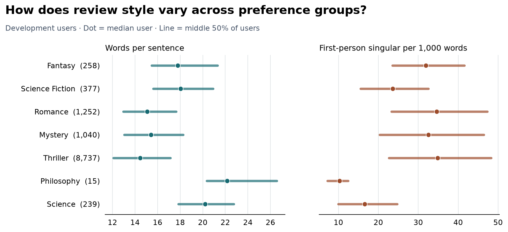

# اندازه‌گیری سبک نوشتار نقدنویسان

سؤال ۱۰ فاز اول می‌پرسد «با استفاده از ویژگی‌های سبک‌شناختی، واژگانی و معناییِ نقدهای کاربران، تا چه حد می‌توان ژانرهای موردعلاقهٔ آن‌ها را پیش‌بینی کرد؟» این بررسی به بخش اندازه‌گیری و تحلیل اکتشافی سؤال می‌پردازد. از هر نقد یک بردار شامل ۲۹ شاخص استخراج شد. برای توصیف گرایش نویسندگان، همان شاخص‌ها را در سطح کاربر هم محاسبه کردیم.

## چه تفاوت‌هایی دیده شد؟

در کل نسخهٔ تثبیت‌شده، ۵۸۴٬۳۵۶ نقد از ۱۷٬۰۲۲ کاربر، پس از پاک‌سازی نمایشی، ۶۵٬۸۶۷٬۷۰۱ واژه و ۴٬۲۹۱٬۱۷۹ واحد جمله داشتند. مقایسهٔ زیر فقط بر اساس ۴۰۵٬۸۱۵ نقدِ ۱۱٬۹۱۲ کاربر بخش توسعه است تا مجموعهٔ آزمون برای ارزیابی بعدی محفوظ بماند. هر عدد میانهٔ شاخص بین کاربران آن گروه است. برای نمونه، ابتدا میانگین طول جمله را برای هر کاربر محاسبه کردیم و سپس میانهٔ کاربران آن گروه را گرفتیم.

## جدول کامل ۲۹ شاخص نوشتاری

نام گروه بیانگر گرایش نقدنویس است. «کل» شامل هر ۱۱٬۹۱۲ کاربر توسعه، با یک بار شمارش هر فرد است. اعداد تا دو رقم اعشار گرد شده‌اند. میانهٔ صفر برای یک نشانگر می‌تواند در کنار مقادیر مثبت برای بعضی کاربران دیده شود.

| ردیف | شاخص | واحد | فانتزی (۲۵۸) | علمی‌تخیلی (۳۷۷) | عاشقانه (۱٬۲۵۲) | معمایی (۱٬۰۴۰) | تریلر (۸٬۷۳۷) | فلسفی (۱۵) | علمی (۲۳۹) | کل |
|---:|---|---|---:|---:|---:|---:|---:|---:|---:|---:|
| ۱ | میانگین طول نقد | واژه در نقد | ۲۱۰٫۹۸ | ۲۰۱٫۳۳ | ۱۶۶٫۲۸ | ۱۱۰٫۱۱ | ۸۲٫۹۰ | ۲۵۳٫۱۷ | ۲۱۱٫۶۷ | ۹۹٫۶۲ |
| ۲ | میانگین تعداد جمله در نقد | جمله در نقد | ۱۱٫۳۶ | ۱۱٫۰۰ | ۱۰٫۶۸ | ۷٫۰۵ | ۵٫۶۴ | ۱۱٫۲۵ | ۱۰٫۵۰ | ۶٫۴۹ |
| ۳ | میانگین تعداد پاراگراف در نقد | پاراگراف در نقد | ۲٫۳۳ | ۲٫۲۵ | ۲٫۱۸ | ۱٫۱۷ | ۱٫۰۵ | ۲٫۴۰ | ۲٫۰۶ | ۱٫۱۲ |
| ۴ | میانگین طول پاراگراف | واژه در پاراگراف | ۸۵٫۱۴ | ۸۲٫۵۳ | ۷۱٫۰۰ | ۶۸٫۳۲ | ۶۰٫۴۵ | ۱۰۹٫۴۰ | ۹۰٫۷۱ | ۶۳٫۴۰ |
| ۵ | میانگین طول جمله | واژه در جمله | ۱۷٫۷۹ | ۱۸٫۰۴ | ۱۵٫۰۷ | ۱۵٫۴۲ | ۱۴٫۴۵ | ۲۲٫۱۶ | ۲۰٫۲۰ | ۱۴٫۹۰ |
| ۶ | انحراف معیار طول جمله | واژه | ۹٫۷۵ | ۱۰٫۱۷ | ۸٫۲۴ | ۸٫۳۲ | ۸٫۱۱ | ۱۳٫۳۶ | ۱۱٫۰۱ | ۸٫۳۰ |
| ۷ | تنوع واژگان در قطعه‌های ۲۰واژه‌ای | درصد واژه‌های متمایز | ۹۱٫۶۳ | ۹۱٫۷۱ | ۹۱٫۷۷ | ۹۱٫۶۰ | ۹۱٫۶۳ | ۹۱٫۳۱ | ۹۱٫۵۳ | ۹۱٫۶۴ |
| ۸ | اول‌شخص مفرد | مورد در هزار واژه | ۳۱٫۸۸ | ۲۳٫۵۶ | ۳۴٫۶۳ | ۳۲٫۵۷ | ۳۴٫۸۳ | ۱۰٫۲۴ | ۱۶٫۶۱ | ۳۳٫۷۲ |
| ۹ | اول‌شخص جمع | مورد در هزار واژه | ۲٫۴۴ | ۲٫۵۹ | ۱٫۹۶ | ۱٫۶۴ | ۱٫۸۲ | ۲٫۵۶ | ۲٫۴۷ | ۱٫۸۵ |
| ۱۰ | دوم‌شخص | مورد در هزار واژه | ۶٫۸۰ | ۶٫۴۹ | ۸٫۴۱ | ۶٫۰۸ | ۷٫۶۵ | ۲٫۲۲ | ۶٫۴۶ | ۷٫۵۰ |
| ۱۱ | صورت‌های کوتاه مانند didn’t | مورد در هزار واژه | ۱۴٫۳۶ | ۱۲٫۵۶ | ۱۴٫۰۱ | ۱۲٫۱۳ | ۱۱٫۹۸ | ۲٫۷۹ | ۵٫۶۳ | ۱۲٫۱۸ |
| ۱۲ | صورت‌های محاوره‌ایِ فهرست‌شده مانند gonna | مورد در هزار واژه | ۰٫۰۰ | ۰٫۰۰ | ۰٫۰۰ | ۰٫۰۰ | ۰٫۰۰ | ۰٫۰۰ | ۰٫۰۰ | ۰٫۰۰ |
| ۱۳ | جمله‌های دارای علامت سؤال در پایان | درصد جمله‌ها | ۲٫۰۸ | ۲٫۷۲ | ۲٫۰۴ | ۱٫۹۰ | ۱٫۶۴ | ۳٫۳۳ | ۱٫۴۲ | ۱٫۷۵ |
| ۱۴ | علامت تعجب | مورد در هزار واژه | ۲٫۳۳ | ۱٫۱۸ | ۶٫۹۷ | ۴٫۲۴ | ۲٫۹۹ | ۰٫۵۰ | ۱٫۰۸ | ۳٫۱۶ |
| ۱۵ | سه‌نقطه | مورد در هزار واژه | ۰٫۹۳ | ۰٫۷۶ | ۰٫۸۴ | ۰٫۳۵ | ۰٫۳۹ | ۰٫۸۰ | ۰٫۴۴ | ۰٫۴۷ |
| ۱۶ | دونقطه | مورد در هزار واژه | ۰٫۸۱ | ۰٫۹۰ | ۰٫۱۶ | ۰٫۰۰ | ۰٫۰۰ | ۲٫۹۶ | ۱٫۷۵ | ۰٫۰۵ |
| ۱۷ | نقطه‌ویرگول | مورد در هزار واژه | ۰٫۳۶ | ۰٫۰۰ | ۰٫۰۰ | ۰٫۰۰ | ۰٫۰۰ | ۱٫۷۹ | ۰٫۶۶ | ۰٫۰۰ |
| ۱۸ | واژه‌های تماماً بزرگ با دست‌کم دو حرف | مورد در هزار واژه | ۲٫۵۶ | ۳٫۴۸ | ۴٫۳۷ | ۱٫۹۳ | ۲٫۸۲ | ۳٫۹۸ | ۳٫۰۵ | ۲٫۸۶ |
| ۱۹ | رشته‌های تأکیدی مانند !!! یا ؟! | مورد در هزار واژه | ۰٫۰۰ | ۰٫۰۰ | ۰٫۵۷ | ۰٫۰۰ | ۰٫۰۰ | ۰٫۰۰ | ۰٫۰۰ | ۰٫۰۰ |
| ۲۰ | جمله‌های دارای نشانگر بند وابسته | درصد جمله‌ها | ۱۷٫۴۵ | ۱۵٫۶۳ | ۱۳٫۰۰ | ۱۲٫۱۲ | ۱۱٫۳۲ | ۱۳٫۷۷ | ۱۴٫۴۳ | ۱۱٫۹۰ |
| ۲۱ | جمله‌های دارای نشانگر تردید | درصد جمله‌ها | ۳٫۶۸ | ۳٫۷۸ | ۱٫۴۷ | ۲٫۰۲ | ۲٫۲۷ | ۳٫۰۲ | ۳٫۹۱ | ۲٫۲۴ |
| ۲۲ | جمله‌های دارای نشانگر قطعیت | درصد جمله‌ها | ۱٫۰۴ | ۰٫۷۳ | ۱٫۰۹ | ۰٫۷۰ | ۰٫۸۶ | ۰٫۰۰ | ۰٫۸۶ | ۰٫۸۷ |
| ۲۳ | جمله‌های دارای نشانگر علت یا نتیجه | درصد جمله‌ها | ۲٫۴۷ | ۲٫۳۱ | ۱٫۹۰ | ۱٫۳۸ | ۱٫۶۴ | ۳٫۰۹ | ۲٫۱۳ | ۱٫۶۸ |
| ۲۴ | جمله‌های دارای نشانگر تقابل | درصد جمله‌ها | ۱۴٫۴۷ | ۱۴٫۶۳ | ۱۲٫۰۲ | ۱۰٫۲۶ | ۱۱٫۷۶ | ۱۴٫۴۴ | ۱۴٫۱۴ | ۱۱٫۸۶ |
| ۲۵ | جمله‌های دارای نشانگر مثال | درصد جمله‌ها | ۰٫۰۰ | ۰٫۰۰ | ۰٫۰۰ | ۰٫۰۰ | ۰٫۰۰ | ۱٫۸۹ | ۱٫۵۲ | ۰٫۰۰ |
| ۲۶ | جمله‌های دارای عبارتِ تجربهٔ خواندن | درصد جمله‌ها | ۱٫۳۸ | ۱٫۲۳ | ۱٫۱۱ | ۱٫۳۴ | ۱٫۷۵ | ۰٫۰۰ | ۰٫۰۰ | ۱٫۵۵ |
| ۲۷ | جمله‌های دارای عبارتِ توصیه به خواندن | درصد جمله‌ها | ۰٫۴۳ | ۰٫۳۵ | ۰٫۶۳ | ۰٫۶۲ | ۰٫۸۱ | ۰٫۵۷ | ۰٫۸۸ | ۰٫۷۵ |
| ۲۸ | جمله‌های دارای عبارتِ توصیف داستان | درصد جمله‌ها | ۰٫۰۰ | ۰٫۰۰ | ۰٫۰۰ | ۰٫۰۰ | ۰٫۰۰ | ۰٫۰۰ | ۰٫۰۰ | ۰٫۰۰ |
| ۲۹ | جمله‌های دارای عبارتِ ارزیابی اثر | درصد جمله‌ها | ۲٫۲۰ | ۱٫۵۹ | ۳٫۶۳ | ۲٫۸۸ | ۳٫۴۱ | ۰٫۰۰ | ۰٫۶۶ | ۳٫۲۳ |

در ردیف‌های ۲۰ تا ۲۹، درصد به جمله‌هایی تعلق دارد که دست‌کم یکی از عبارت‌های فهرست‌شده در آن‌ها دیده شده است. برای نمونه، ردیف ۲۸ عبارت‌های مشخصِ معرفی داستان را می‌شمارد. نتیجهٔ مقایسه با خواندن مستقیم جمله‌ها در بخش «کنترل شاخص‌های تفسیری» آمده است.

برای اول‌شخص مفرد، نیمهٔ میانی کاربران علمی در محدودهٔ ۹٫۹ تا ۲۴٫۷ و کاربران عاشقانه در محدودهٔ ۲۳٫۳ تا ۴۷٫۳ مورد در هزار واژه قرار گرفتند. در معمایی و تریلر نیز نیمهٔ میانی به‌ترتیب ۲۰٫۳ تا ۴۶٫۴ و ۲۲٫۶ تا ۴۸٫۲ بود. این هم‌پوشانی برای برآورد گرایش یک نفر مهم است. میانهٔ تنوع واژگانی در قطعه‌های ۲۰واژه‌ای هم در هر هفت گروه بین ۹۱٫۳٪ و ۹۱٫۸٪ بود. در این داده و با این تعریف، میانه‌های این شاخص به هم نزدیک‌اند. تعداد کاربران فلسفی برای تعمیم محدود است. هر فردِ چندعضوی در خلاصهٔ هر گروه خودش حاضر است، اما در ردیف کلی یک بار شمرده می‌شود.



**وقتی ژانر کتاب مشترک باشد چه می‌شود؟** در نقدهای کتاب‌های تریلر، میانهٔ اول‌شخص برای ۱۱۱ علاقه‌مند علمی‌تخیلی، ۲۳٫۱ و برای ۶۵۹ علاقه‌مند عاشقانه، ۳۶٫۸ در هزار واژه بود. به‌ترتیب ۱۹۰ و ۱٬۹۱۸ نقد در این مقایسه شرکت دارند. این محدودسازی، ژانر کتاب را ثابت می‌گیرد. عنوان کتاب و تعداد نقدهای قابل استفادهٔ افراد همچنان متغیر است. در گروه علمی فقط ۸ کاربر دربارهٔ تریلر نوشته‌اند و در گروه فلسفی کسی در این مقایسه حاضر نیست. [خلاصهٔ همهٔ شاخص‌ها، حجم نمونه و چارک‌ها](group_style.csv)

**نقدهای این کاربران در مقایسه با کل آرشیو چگونه‌اند؟** از تمام ۲۹٬۴۷۵٬۴۵۳ ردیف آرشیو با احتمال ثابت ۰٫۱٪ نمونه گرفتیم. از ۲۹٬۳۸۷ ردیف انتخاب‌شده، ۲۹٬۳۸۵ متن غیرخالی بود. برای مقایسهٔ هم‌واحد، از نقدهای توسعهٔ کاربران واجد شرایط نیز با احتمال یک‌شانزدهم نمونه گرفتیم. جدول زیر میانهٔ **نقدها** را نشان می‌دهد. هر نقد در آن یک مشاهده است.

| مجموعهٔ نقدها | تعداد نقد | واژه در نقد | واژه در جمله | اول‌شخص مفرد در هزار واژه |
|---|---:|---:|---:|---:|
| نمونه از همهٔ نقدهای غیرخالی آرشیو | ۲۹٬۳۸۵ | ۳۲ | ۱۱٫۸ | ۲۲٫۷ |
| همان نمونه با شرط حداقل ۲۰ توکن خام | ۲۰٬۰۲۴ | ۵۵ | ۱۴٫۵ | ۳۳٫۳ |
| نمونه از نقدهای کاربران واجد شرایط | ۲۵٬۵۱۹ | ۶۷ | ۱۳٫۷ | ۳۰٫۳ |

برای ۱۹ متن غیرخالی آرشیو، پس از پاک‌سازی واژه‌ای باقی نماند. نرخ‌های نیازمند مخرج مثبت برای آن‌ها مقدار ناموجود گرفتند. اختلاف دو ردیف اول نشان می‌دهد شرط طول متن به‌تنهایی ترکیب نقدها و میانه‌ها را تغییر می‌دهد. آرشیو شامل نقدهای کاربران واجد شرایط هم هست و این خط مبنا توصیفی است. [توزیع ۲۹ شاخص در نمونهٔ آرشیو](review_reference.csv)

**آیا شدت گرایش با نوشتار همراه است؟** در هر یک از ۱۱٬۹۱۲ کاربر توسعه، سهم پیوستهٔ هر ژانر را از تعداد کتاب‌های متمایزِ نقدشده در آن ژانر نسبت به همهٔ کتاب‌های متمایزِ نقدشدهٔ همان فرد گرفتیم. اگر سابقهٔ او هیچ کتاب نگاشت‌شده‌ای در آن ژانر نداشت، سهم مشاهده‌شده صفر بود. برای هر شاخص، همبستگی رتبه‌ای اسپیرمن را بین کاربران محاسبه کردیم. برای سهم تریلر، ضریب با طول متوسط نقد **منفی ۰٫۴۴**، با طول متوسط جمله **منفی ۰٫۲۸** و با اول‌شخص مفرد **مثبت ۰٫۰۹** بود. برای سهم علمی، ضریب با طول جمله **مثبت ۰٫۱۰** بود. بین سهم تریلر و تنوع واژه در پنجره‌های ۲۰تایی، ضریب **منفی ۰٫۰۱** بود.

این مقایسهٔ اکتشافی به کاربران واجد شرایطِ هفت گروه مربوط است. چون ورود به مجموعه به حداقل ۱٬۰۰۰ توکن وابسته است، کاربرانِ دارای نقدهای کوتاه برای ورود معمولاً به نقدهای بیشتری نیاز دارند. طول نقد، فعالیت نویسنده و ترکیب ژانرهای او می‌توانند در همبستگی‌ها مؤثر باشند. ضرایب توصیفی‌اند و به‌تنهایی دقت پیش‌بینی کاربر تازه را تعیین نمی‌کنند. [همبستگی همهٔ شاخص‌ها و تعداد کاربران دارای سهم مثبت](style_correlations.csv)

## تعریف شاخص‌ها

| جنبه | ستون یا خانوادهٔ ستون | تعریف |
|---|---|---|
| اندازه و سازمان متن | `words_per_review`، `sentences_per_review`، `paragraphs_per_review`، `words_per_paragraph` | نسبت مجموع واژه، جمله یا پاراگراف به مخرج متناظر. پاراگراف با خط خالی یا تگ بلوکی و با دست‌کم یک واژه شناسایی می‌شود. |
| جمله‌بندی | `mean_sentence_words`، `sd_sentence_words` | میانگین طول جمله و انحراف معیار جمعیت جمله‌های مشاهده‌شده. پراکندگی با دست‌کم دو جمله گزارش می‌شود. |
| تنوع واژه | `vocabulary_diversity_20_pct` | در هر نقد، واژه‌ها پس از یکسان‌کردن بزرگی حروف به قطعه‌های ۲۰تاییِ غیرهم‌پوشان تقسیم می‌شوند. میانگین درصد صورت‌های واژگانی متمایز در قطعه‌های کامل محاسبه می‌شود. قطعه از مرز نقد عبور نمی‌کند. باقی‌ماندهٔ کمتر از ۲۰ واژه کنار می‌رود و بدون قطعهٔ کامل، مقدار ناموجود است. |
| خطاب، خودارجاعی و محاوره | `first_singular`، `first_plural`، `second_person`، `contractions`، `colloquial_tokens` با پسوند `_per_1000_words` | شمار صورت‌های فهرست‌شده در هزار واژه. صورت کوتاه و سرِ ضمیریِ آن جدا شمرده می‌شوند. فهرست محاوره، صورت‌هایی مثل gonna و yep را پوشش می‌دهد. |
| نشانه‌گذاری و تأکید | `question_ending_pct`، و نرخ‌های `exclamations`، `ellipses`، `colons`، `semicolons`، `upper_tokens`، `emphatic_runs` | درصد واحدهای جمله با پایان دارای علامت سؤال، و شمار هر نشانه در هزار واژه. رشتهٔ متوالیِ دست‌کم دو علامت سؤال یا تعجب یک مورد تأکید شمرده می‌شود. یک واژهٔ تماماً بزرگ حداقل دو حرف دارد و مخفف‌هایی مثل USA نیز شمرده می‌شوند. |
| نشانهٔ نحوی، نحوهٔ قضاوت و استدلال | `subordination`، `hedge`، `certainty`، `causal`، `contrast`، `example` با پسوند `_sentence_pct` | درصد جمله‌های دارای دست‌کم یک عبارت متناظر با وابستگی، تردید، قطعیت، علت، تقابل یا مثال. تکرار یک نوع عبارت در یک جمله فقط یک بار شمرده می‌شود. |
| عبارت‌های مرتبط با کارکرد نقد | `reading_experience`، `recommendation`، `plot_description`، `evaluation` با پسوند `_sentence_pct` | درصد جمله‌های دارای عبارت‌هایی مانند «وقتی خواندم»، «توصیه می‌کنم»، «داستان دربارهٔ ... است»، یا «خوب نوشته شده». یک جمله می‌تواند در چند دسته شمرده شود. |

فهرست کامل و ثابت عبارت‌های انگلیسی در فایل [تعریف شاخص‌ها](../../../src/style_indicators.py) است. نرخ هر کاربر از مجموع صورت و مخرج نقدهای همان کاربر ساخته می‌شود. به این ترتیب متنی که سه واژه دارد به اندازهٔ یک نقد طولانی در نرخ واژه‌ایِ آن فرد اثر نمی‌گذارد. در مرحلهٔ مقایسه، هر کاربر یک مشاهده است. قواعد طول جمله، آپاستروف و رمزگشایی HTML در [گزارش آزمایش اولیه](../writing-style-fa.md) آمده است.

## کنترل شاخص‌های تفسیری

برای هر یک از هفت گرایش، ۸ کاربر تک‌عضوی از بخش توسعه و از هر کاربر یک نقد و یک جمله با هش ثابت انتخاب شد. ۵۶ جمله با شناسهٔ مستعار و بدون نمایش نام گروه بررسی شدند. کدگذاری تفسیری را Codex در یک نوبت انجام داد. در این ۹۲۰ واژه، ۸۲ صفت و ۵۱ قید ثبت شد. در ۲۱ جمله دست‌کم یک بند وابستهٔ دارای فعل صرف‌شده تشخیص داده شد، در مجموع ۲۹ بند. نقش کلمه بر اساس جمله تعیین شد. مصدرها و بندهای وجه وصفی در شمار بندهای صرف‌شده وارد نشدند. این شمارش دستوری مربوط به نمونه است.

برای کارکردها، تجربهٔ خواندن شامل اشاره به فرایند خواندن یا درگیرشدن شخصی با متن است. توصیه شامل راهنمایی دربارهٔ خواندن کتاب، توصیف داستان شامل شخصیت، رویداد یا فضای داستان، و ارزیابی شامل داوری در مورد اثر یا نویسنده است. چند برچسب برای یک جمله مجاز بود. نمونه کوچک است و هر هفت گروه به تعداد مساوی در آن حضور دارند.

| کارکرد یا ساختار | موارد تشخیص‌داده‌شده در بازخوانی | موارد مثبت طبق نشانگر خودکار | اشتراک این دو |
|---|---:|---:|---:|
| تجربهٔ خواندن | ۴ | ۰ | ۰ |
| توصیه | ۳ | ۱ | ۱ |
| توصیف داستان | ۱۲ | ۰ | ۰ |
| ارزیابی | ۳۲ | ۴ | ۴ |
| وجود بند وابستهٔ صرف‌شده | ۲۱ | ۱۱ | ۱۰ |

در این نمونه، نویسنده‌ها داستان را اغلب با تعریف مستقیم رویدادها توصیف می‌کنند و نیازی به عبارت «داستان دربارهٔ ... است» ندارند. نرخ نشانگرهای متنی را فقط به معنای حضور همان عبارت‌ها می‌توان گزارش کرد. تخمین فراوانی واقعی کارکردها و مقایسهٔ دستوریِ تمام کاربران به اعتبارسنجی گسترده‌تر نیاز دارد. [برچسب‌های ۵۶ جمله](sentence_annotations.csv)

در مجموعهٔ کامل، ۹۱٬۹۶۵ نقد دارای نشان گیومه یا تگ نقل‌قول بودند و در ۳۳۰ نقد هیچ‌یک از واژه‌های انگلیسی مرجعِ محدود ما دیده نشد. این نشانه‌ها زبان و نویسندهٔ واقعی نقل‌قول را تعیین نمی‌کنند. یک مقایسهٔ حساسیت برای نقدهای بدون نشان نقل‌قول و دارای حداقل یک واژهٔ انگلیسی مرجع در `group_style.csv` با عنوان `no_quote_with_english_anchor` آمده است. منشأ گرایش در این داده، رفتار نقدنویسیِ کل سابقه است. اندازه‌گیری‌ها دامنهٔ هفت گروه منتخب و متن نقدهای ثبت‌شده در آمازون را پوشش می‌دهند.

## فایل‌ها و تکرار تحلیل

- جدول هر کاربر (`user_style.csv`، خروجی محلی) و جدول هر نقد (`review_style.csv.gz`، خروجی محلی) شمارش‌های خام، مخرج‌ها و ۲۹ شاخص را نگه می‌دارند. جدول کاربر به تفکیک ژانر کتاب نقدشده (`user_book_genre_style.csv.gz`، خروجی محلی) برای مقایسه در یک ژانر مشترک است. شناسه‌ها برای اتصال فایل‌ها هستند.
- [شمارش‌ها و هش‌ها](measurement.json) برای کنترل نسخهٔ داده، کد و خروجی اصلی ثبت شده‌اند. ژانر نامشخص کتاب با `book=UNMAPPED` در جدول گروهی دیده می‌شود. `ALL` تمام کاربران واجد شرایط آن مقایسه را یک‌بار می‌شمارد.
- فرمان‌های زیر از ریشهٔ پروژه اجرا می‌شوند. استخراج با Python 3.14.3 انجام شد. برای همبستگی و نمودار از pandas 3.0.6 و matplotlib 3.11.2 استفاده شد. نتایج توصیفی بدون برازش مدل پیش‌بینی محاسبه شده‌اند.

```console
python src/measure_corpus_style.py
python src/style_review_reference.py
python src/check_style_annotations.py --labels reports/phase2/style-v1/sentence_annotations.csv
python src/describe_style_groups.py
```
