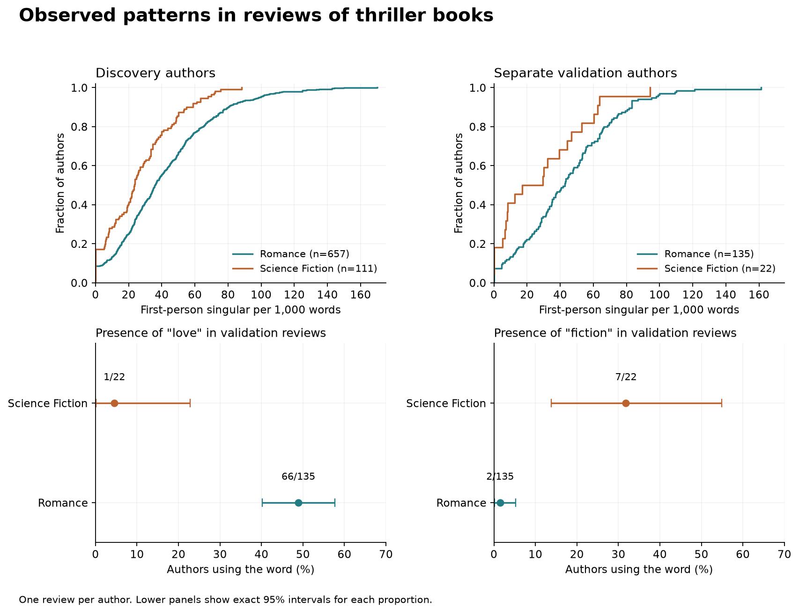

# ممیزی شواهد آماری فاز دوم

این ممیزی پس از پرسش کاربر دربارهٔ اتکاپذیری الگوها انجام شد. نسخهٔ مرجعِ تحلیل اکتشافی کامیت dfd8b18 است. تعریف ویژگی، تکرارپذیری اندازه‌گیری، تفاوت گروه‌ها و تعمیم به کاربر جداگانه، هرکدام شواهد مخصوص خود را می‌خواهند.

## نتیجهٔ اصلی

دو خوشهٔ واژگانی در اجراهای مختلف تکرارپذیرند، ولی جدایی هندسی آن‌ها کم است و ارتباطشان با طول و موضوع نقد بیشتر از گرایش مرجع نویسنده است. چند واژه تفاوت مشاهده‌شدهٔ قابل تکرار دارند. برای بسیاری از واژه‌ها و شاخص‌های دیگر، تعمیم هنوز پشتیبانی کافی ندارد.

## طرح بررسی تکمیلی

پیش از محاسبهٔ تفاوت‌های کاربران جداگانه، فهرست ۲۴ واژهٔ قبلی و هر ۲۹ شاخص ثابت شدند. دو فرضیهٔ اصلیِ سبک، اول‌شخص مفرد و طول جمله، از گزارش قبلی آمده‌اند. تنظیمات در protocol.json ثبت شدند. واژگان، وزن‌ها، مؤلفه‌ها و مرکزهای خوشه از بخش توسعهٔ قبلی استفاده شدند.

از بخش اعتبارسنجیِ کاربران، از هر نفر یک نقد با همان قاعدهٔ قبلی انتخاب شد. ۲٬۵۷۰ نویسنده در این بخش حضور دارند. مقایسهٔ ژانر مشترک شامل ۱۳۵ عاشقانه‌خوان و ۲۲ علمی‌تخیلی‌خوان است که هر کدام دربارهٔ یک کتاب تریلر نوشته‌اند. گرایش اصلی آن‌ها پس از حذف این کتابِ خارج از ژانرِ گرایش همچنان حفظ می‌شود. نویسندگان این مقایسه با نمونهٔ اکتشافی مشترک نیستند. متن تکراریِ دقیق پس از پاک‌سازی هم در برابر نمونهٔ اکتشافی یافت نشد.

این داده از همان آرشیو آمازون است و تکرار در منبع بیرونی به شمار نمی‌آید. بخش اعتبارسنجی از این نقطه در توسعهٔ تحلیل استفاده شده است. برای ارزیابی نهایی مدل باید نقش آن روشن باشد. مجموعهٔ آزمون نهایی در این ممیزی به کار نرفته است.

## خوشه‌ها چقدر قابل اتکا هستند؟

در تحلیل اولیه، سیلوئت حدود ۰٫۰۴۳ و توافق شروع‌های مختلف حدود ۰٫۹۹ بود. در نویسندگان جداگانه، با همان مرکزهای قبلی، سیلوئت 0.053 و اندازهٔ دو گروه 1279 و 1290 شد. برای یک نقد، واژهٔ شناخته‌شده‌ای در بازنمایی باقی نماند. این عددهای نزدیک به صفر، هم‌پوشانی زیاد گروه‌ها را نشان می‌دهند.

برای تشخیص اندازهٔ این جدایی، ۳۹ مجموعه از یک توزیع نرمال با میانگین و کوواریانس همان فضا شبیه‌سازی و مانند داده نرمال شدند. روی نمونه‌های ۱٬۸۰۰نفری، میانهٔ سیلوئت مرجع 0.042 و صدک‌های ۵ تا ۹۵ آن 0.039 تا 0.044 بود. در نمونهٔ واقعیِ هم‌اندازه، سیلوئت 0.047 بود. تفاوت اندکی دیده می‌شود. این یک بررسی تشخیصیِ وابسته به مدل مرجع است.

اثر حذف نرمال‌سازی و تغییر تعداد مؤلفه‌ها در گزارش قبلی ثبت شده است. ارتباط خام خوشه با گرایش حدود ۰٫۰۴۳ بیت و افزودهٔ آن نسبت به خط مبنا پس از لحاظ‌کردن ژانر کتاب و پنجک طول حدود ۰٫۰۰۳۶ بیت بود. در مقایسهٔ عنوان یکسان، شواهد فراتر از خط مبنا به دست نیامد. این خروجی برای ادعای کشف گروه‌های طبیعیِ علاقه‌مندان ژانرها کفایت نمی‌کند.

## آیا واژگان فقط رتبه گرفته بودند؟

فهرست اولیه از شمار واقعیِ نویسندگانِ استفاده‌کننده از واژه و نسبت شانس ساخته شده بود. با این حال، رتبهٔ بالا به‌تنهایی تعمیم را تأیید نمی‌کند. در ممیزی جدید، برای ۱۲هزار ویژگی در هفت گروه، ۸۴هزار مقایسهٔ دقیق فیشر انجام شد. اصلاح بنجامینی–یکوتیلی در کل این خانواده اعمال شد تا وابستگی بین واژه‌ها هم لحاظ شود.

برای پایداری رتبه، نویسندگان هر طرف ۲۰۰ بار بازنمونه‌گیری و فهرست ۱۵تایی دوباره ساخته شد. جدول زیر دو جنبه را جدا گزارش می‌کند. ستون آخر نشان می‌دهد چند واژه در دست‌کم ۸۰٪ این بازنمونه‌گیری‌ها در میان ۱۵ مورد نخست مانده‌اند. این ۸۰٪ یک توصیف پایداری رتبه است.

| گروه | کاربران | واژهٔ گزارش‌شده | مقایسه با p اصلاح‌شده زیر ۰٫۰۵ | حفظ رتبه در ۸۰٪ اجراها |
|---|---|---|---|---|
| فانتزی | 189 | 15 | 15 | 3 |
| علمی‌تخیلی | 295 | 15 | 15 | 5 |
| عاشقانه | 1104 | 15 | 15 | 11 |
| معمایی | 948 | 15 | 15 | 9 |
| تریلر | 8229 | 15 | 12 | 5 |
| فلسفی | 10 | 10 | 2 | 2 |
| علمی | 193 | 15 | 15 | 8 |

تفاوتِ فراوانی در همین مجموعه برای بسیاری از واژه‌ها شواهد آماری دارد، اما ترتیب دقیق واژه‌های برجسته می‌تواند تغییر کند. در گروه فلسفی فقط ۱۰ نفر حضور دارند و اتکای فهرست به چند نفر زیاد است. موضوع کتاب و انتخاب عنوان نیز می‌توانند تفاوت واقعی در واژگان ایجاد کنند.

## واژگان در نویسندگان جداگانه چه شدند؟

از ۲۴ واژهٔ از پیش انتخاب‌شده در مقایسهٔ کتاب‌های تریلر، 19 مورد همان جهت تفاوت را در کاربران جداگانه داشتند. پس از آزمون دقیق فیشر و اصلاح بنجامینی–یکوتیلی برای هر ۲۴ مورد، 2 مورد شواهد کافی در آستانهٔ ۰٫۰۵ داشتند.

| واژه | عاشقانه‌خوان‌ها | علمی‌تخیلی‌خوان‌ها | p اصلاح‌شده |
|---|---|---|---|
| love | 66/135 (48.9٪) | 1/22 (4.5٪) | 0.0018 |
| fiction | 2/135 (1.5٪) | 7/22 (31.8٪) | 0.0011 |

در ۱۵۷ نقد این مقایسه، ۱۴۷ عنوان کتاب متمایز وجود داشت. استفاده از love در ۶۳ عنوانِ مربوط به عاشقانه‌خوان‌ها دیده شد. با بازنمونه‌گیری عنوان‌ها به‌جای افراد، بازهٔ اختلاف فراوانی love همچنان مثبت و برای fiction همچنان منفی بود. این شواهد به همین دو گروه و نقد کتاب‌های تریلر مربوط است.

برای ۲۲ واژهٔ دیگر، اندازه و جهت اثر و تعداد استفاده‌کنندگان در word_replication.csv آمده است. کوچک‌بودن نمونهٔ علمی‌تخیلی‌خوان‌ها عدم‌قطعیت را زیاد می‌کند. برای تعمیم کل فهرست هفت ژانر به کاربران تازه به بررسی جداگانهٔ بیشتری نیاز داریم.



## دیگر شاخص‌های نوشتاری

شمارش علامت تعجب، واژه یا صورت ضمیر، تحت قواعد اعلام‌شده قابل تکرار است. تفسیر آن به‌عنوان هیجان، پیچیدگی، استدلال یا ویژگی ثابتِ شخص نیازمند شواهد بیشتری است. برای نمونه، در دو نقد جدا از هر نویسنده، همبستگی طول جمله حدود ۰٫۴۶، اول‌شخص مفرد ۰٫۳۱ و تنوع واژگان ۰٫۰۸ است. مقایسه‌های هم‌ژانر و متن‌های بلند هم در گزارش تکرارپذیری ثبت‌اند.

در کاربران جداگانه، جهت اختلاف اول‌شخص مفرد با گزارش اولیه هم‌سو بود. آزمون تفاوت توزیع‌ها، پس از اصلاح برای دو فرضیهٔ اصلی، p برابر 0.0238 داشت. اختلاف میانه 19.4 مورد در هزار واژه و بازهٔ بوت‌استرپ آن -2.5 تا 37.2 بود. بازه شامل صفر است، بنابراین مقدار اختلاف میانه هنوز با عدم‌قطعیت زیادی همراه است. آزمون توزیع و بازهٔ اختلاف میانه دو پرسش آماری متفاوت دارند.

برای طول جمله در کاربران جداگانه، p اصلاح‌شدهٔ دو فرضیهٔ اصلی 0.0878 و بازهٔ اختلاف میانه -5.3 تا 1.1 واژه بود. برای تفاوت این شاخص در این نمونه شواهد کافی به دست نیامد.

وقتی هر ۲۹ شاخص را هم‌زمان با اصلاح محافظه‌کارانه بررسی کردیم، در بخش اعتبارسنجی هیچ موردی از آستانهٔ ۰٫۰۵ عبور نکرد. این نتیجه، دامنهٔ ادعا را محدود می‌کند. دو فرضیهٔ اصلی از قبل در گزارش قبلی مشخص بودند و نتیجهٔ آن‌ها جداگانه نیز گزارش شد.

به‌علت صفرهای زیاد و مقادیر مساوی در برخی شاخص‌ها، احتمال‌های آزمونِ رتبه‌ها با ۹٬۹۹۹ جابه‌جاییِ عضویت گروه محاسبه شد. تقریب نرمال برای شاخص‌های بسیار کم‌وقوع کنار گذاشته شد. این اصلاحِ روش محاسبه در جریان ممیزی انجام شد و گزینش شاخص‌ها و گروه‌ها ثابت ماند.

برای شاخص‌های مبتنی بر عبارتِ توصیه، توصیف داستان و تجربهٔ خواندن، بازخوانی قبلی توسط دستیار در ۵۶ جمله پوشش ضعیف واژه‌نامه را نشان داده بود. مثلاً از ۱۲ جملهٔ توصیف داستان، هیچ‌کدام عبارتِ واژه‌نامه را نداشتند. ارزیاب انسانیِ مستقل در آن بازخوانی حضور نداشت. این ستون‌ها باید با عنوان حضور همان عبارت‌ها خوانده شوند.

## جدول شواهد هر ۲۹ شاخص

| شاخص | نوع اندازه‌گیری | تکرارپذیری دو نقد | درصد صفر در نقد منتخب | p اصلاح‌شدهٔ ۲۹تایی در کاربران جداگانه |
|---|---|---|---|---|
| طول نقد | شمارش با تعریف عملیاتی | 0.59 | 0.0 | 1.000 |
| تعداد جمله در نقد | شمارش با تعریف عملیاتی | 0.54 | 0.0 | 1.000 |
| تعداد پاراگراف در نقد | شمارش با تعریف عملیاتی | 0.59 | 0.0 | 1.000 |
| طول پاراگراف | شمارش با تعریف عملیاتی | 0.46 | 0.0 | 1.000 |
| طول متوسط جمله | شمارش با تعریف عملیاتی | 0.46 | 0.0 | 1.000 |
| پایان پرسشی | شمارش با تعریف عملیاتی | 0.16 | 85.8 | 1.000 |
| تنوع واژه در قطعهٔ ۲۰واژه‌ای | شمارش با تعریف عملیاتی | 0.08 | 0.0 | 1.000 |
| اول‌شخص مفرد | شمارش با تعریف عملیاتی | 0.31 | 18.2 | 0.342 |
| اول‌شخص جمع | شمارش با تعریف عملیاتی | 0.19 | 81.0 | 1.000 |
| دوم‌شخص | شمارش با تعریف عملیاتی | 0.18 | 58.4 | 1.000 |
| صورت‌های کوتاه | شمارش با تعریف عملیاتی | 0.29 | 41.8 | 1.000 |
| علامت تعجب | شمارش با تعریف عملیاتی | 0.40 | 68.3 | 0.236 |
| سه‌نقطه | شمارش با تعریف عملیاتی | 0.30 | 87.0 | 1.000 |
| دونقطه | شمارش با تعریف عملیاتی | 0.25 | 90.6 | 0.549 |
| نقطه‌ویرگول | شمارش با تعریف عملیاتی | 0.22 | 93.1 | 1.000 |
| واژهٔ تماماً بزرگ | شمارش با تعریف عملیاتی | 0.20 | 73.6 | 1.000 |
| رشتهٔ نشانه‌های تأکید | شمارش با تعریف عملیاتی | 0.31 | 92.7 | 1.000 |
| صورت‌های محاوره‌ای فهرست‌شده | شمارش با تعریف عملیاتی | 0.12 | 97.3 | 1.000 |
| عبارتِ وابستگی جمله | نشانگر واژه‌نامه‌ای با نیاز به اعتبارسنجی معنا | 0.15 | 47.0 | 1.000 |
| عبارتِ تردید | نشانگر واژه‌نامه‌ای با نیاز به اعتبارسنجی معنا | 0.13 | 81.7 | 1.000 |
| عبارتِ قطعیت | نشانگر واژه‌نامه‌ای با نیاز به اعتبارسنجی معنا | 0.10 | 90.4 | 1.000 |
| عبارتِ علت یا نتیجه | نشانگر واژه‌نامه‌ای با نیاز به اعتبارسنجی معنا | 0.11 | 84.6 | 1.000 |
| عبارتِ تقابل | نشانگر واژه‌نامه‌ای با نیاز به اعتبارسنجی معنا | 0.18 | 45.7 | 0.342 |
| عبارتِ مثال | نشانگر واژه‌نامه‌ای با نیاز به اعتبارسنجی معنا | 0.10 | 97.7 | 0.236 |
| عبارتِ تجربهٔ خواندن | نشانگر واژه‌نامه‌ای با نیاز به اعتبارسنجی معنا | 0.08 | 87.1 | 1.000 |
| عبارتِ توصیه | نشانگر واژه‌نامه‌ای با نیاز به اعتبارسنجی معنا | 0.15 | 91.0 | 1.000 |
| عبارتِ توصیف داستان | نشانگر واژه‌نامه‌ای با نیاز به اعتبارسنجی معنا | 0.06 | 97.5 | 1.000 |
| عبارتِ ارزیابی | نشانگر واژه‌نامه‌ای با نیاز به اعتبارسنجی معنا | 0.09 | 77.0 | 1.000 |
| پراکندگی طول جمله | شمارش با تعریف عملیاتی | 0.34 | 0.4 | 1.000 |

## محدودیت و جایگاه نتیجه

مقایسه‌ها بر دادهٔ مشاهده‌ایِ کاربران واجد شرایط در هفت گروه آمازون انجام شده‌اند. امکان تفاوت در انتخاب عنوان، ژانرهای فرعی کتاب، امتیاز، زمان و فرصت مواجهه وجود دارد. آزمون آماریِ رابطه، توان پیش‌بینیِ کاربر تازه یا رابطهٔ علت‌ومعلولی را تعیین نمی‌کند. مجموعهٔ آزمون نهایی برای آن ارزیابی لازم است.

بخشی از ویژگی‌های قبلی به‌عنوان نامزد اکتشافی ساخته شده بودند. اکنون برای بعضی واژه‌ها، شمار واقعی، اندازهٔ تفاوت، پایداری رتبه و تکرار در کاربران جداگانه داریم. برای خوشه‌ها و بسیاری از شاخص‌های دیگر، نتیجه با اندازهٔ اثر و عدم‌قطعیت محدود گزارش می‌شود.

## بازتولید و منابع

فرمان‌ها از ریشهٔ مخزن اجرا می‌شوند. خروجی فردی زیر data/analysis/validity-v1 قرار می‌گیرد.

```console
python src/audit_phase2_validity.py freeze
python src/audit_phase2_validity.py words
python src/audit_phase2_validity.py replicate
python src/audit_phase2_validity.py clusters
python src/audit_phase2_validity.py books
python src/build_validity_report.py
```

- [جدول کامل راستی‌آزمایی واژه‌ها](word_replication.csv)
- [جدول شواهد شاخص‌ها](indicator_evidence.csv)
- [مقایسه‌های سبکی با اندازهٔ اثر و بازه](common_style_evidence.csv)
- [حساسیت به عنوان کتاب](book_sensitivity.csv)

- [تعریف و تفسیر سیلوئت](https://scikit-learn.org/stable/modules/generated/sklearn.metrics.silhouette_score.html)
- [آزمون دقیق فیشر](https://docs.scipy.org/doc/scipy/reference/generated/scipy.stats.fisher_exact.html)
- [اصلاح آزمون‌های متعدد و وابسته](https://docs.scipy.org/doc/scipy/reference/generated/scipy.stats.false_discovery_control.html)
- [آزمون رتبه‌ای و مقادیر مساوی](https://docs.scipy.org/doc/scipy/reference/generated/scipy.stats.mannwhitneyu.html)
